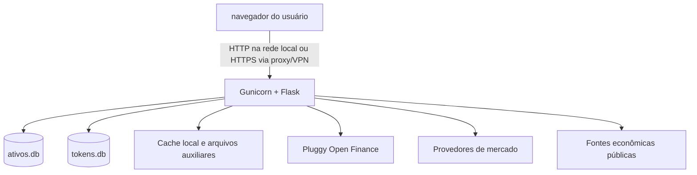

<div align="center">
  
  <h1>Lonely Wallet</h1>
  <p><strong>Gerenciador pessoal de carteira de investimentos, auto-hospedado em Docker.</strong></p>
  <p>
    <strong>Versão 5.0.0</strong> · Interface em português (Brasil) · Python/Flask · SQLite · Docker
  </p>
</div>

---

## Índice

- [Sobre o projeto](#sobre-o-projeto)
- [Principais recursos](#principais-recursos)
- [Como os dados são obtidos](#como-os-dados-são-obtidos)
- [Arquitetura](#arquitetura)
- [Requisitos](#requisitos)
- [Instalação no ZimaOS/CasaOS](#instalação-no-zimaoscasaos)
- [Instalação com Docker Compose](#instalação-com-docker-compose)
- [Primeiro acesso e proteção por PIN](#primeiro-acesso-e-proteção-por-pin)
- [Guia de uso](#guia-de-uso)
  - [Resumo](#1-resumo)
  - [Proventos](#2-proventos)
  - [Patrimônio](#3-patrimônio)
  - [Lançamentos](#4-lançamentos)
  - [Importação da B3](#5-importação-da-b3)
  - [Distribuição da carteira](#6-distribuição-da-carteira)
  - [Integrações e APIs](#7-integrações-e-apis)
  - [Segurança](#8-segurança)
- [Configuração da Pluggy](#configuração-da-pluggy)
- [Provedores de dados](#provedores-de-dados)
- [Configurações do container](#configurações-do-container)
- [Arquivos e persistência](#arquivos-e-persistência)
- [Backup e restauração](#backup-e-restauração)
- [Atualização de versão](#atualização-de-versão)
- [Diagnóstico e solução de problemas](#diagnóstico-e-solução-de-problemas)
- [API HTTP interna](#api-http-interna)
- [Desenvolvimento e testes](#desenvolvimento-e-testes)
- [Limitações conhecidas e avisos](#limitações-conhecidas-e-avisos)
- [Privacidade e segurança operacional](#privacidade-e-segurança-operacional)
- [Licença](#licença)

---

## Sobre o projeto

O **Lonely Wallet** é uma aplicação pessoal para registrar e acompanhar uma carteira de investimentos. Ela é executada no próprio servidor do usuário, normalmente em um equipamento com ZimaOS/CasaOS e Docker, e é acessada pelo navegador de um computador, tablet ou celular.

A aplicação reúne em uma única interface:

- posições e patrimônio por classe de ativo;
- compras, vendas e operações agendadas;
- proventos recebidos e eventos de pagamento anunciados;
- importação de movimentações por planilha Excel da B3;
- integração Open Finance com a Pluggy;
- fontes externas de cotações, histórico e indicadores econômicos;
- distribuição atual da carteira e percentuais-alvo;
- proteção de acesso por PIN.

O servidor local é a fonte central dos dados. Abrir a aplicação em outro dispositivo não cria uma carteira separada: os dispositivos acessam os mesmos bancos SQLite montados no servidor.

### Destaques da versão 5.0.0

- A página **Proventos** não exibe mais o contador técnico de eventos novos/ignorados nem a seção de detalhes técnicos da sincronização.
- A página **Integrações e APIs** não exibe mais o painel visual de consumo de chamadas e cache. Os controles internos de cache, intervalos e limites dos provedores continuam ativos.
- O cartão Pluggy segue o tema visual dos demais provedores e recebe o selo verde **(Recomendado)** ao lado do nome.

> **Importante:** o Lonely Wallet é uma ferramenta de organização e acompanhamento. Não é corretora, custodiante, instituição financeira, serviço de recomendação de investimentos ou sistema oficial de apuração tributária.

## Principais recursos

| Área | O que oferece |
|---|---|
| **Resumo** | Indicadores consolidados, evolução do patrimônio, alocação e grupos de ativos. |
| **Proventos** | Recebimentos confirmados, eventos anunciados, filtros por período, classe e ativo, histórico e distribuição. |
| **Patrimônio** | Evolução histórica e composição da carteira por classe. |
| **Lançamentos** | Cadastro, edição, exclusão e exportação de compras e vendas. |
| **Importação B3** | Prévia, importação e gerenciamento de lotes de planilhas `.xlsx` exportadas pela B3. |
| **Distribuição** | Definição de percentuais-alvo e comparação com a composição atual. |
| **Integrações e APIs** | Configuração de credenciais, provedores de mercado e conexões Pluggy. |
| **Segurança** | Configuração, alteração e desativação do PIN e bloqueio manual da sessão. |

### Classes de ativos

O cadastro de operações reconhece as seguintes classes: Ações, FIIs, ETFs, BDRs, ETFs Internacionais, Stocks, REITs, Criptomoedas, Renda Fixa, Tesouro Direto, Fundos de Investimentos e Outros.

A disponibilidade de cotação, histórico, indicadores e cálculo de saldo varia conforme a classe e os dados disponibilizados pelas fontes configuradas. A página **Proventos** é destinada a ativos com eventos de proventos elegíveis; títulos de renda fixa e Tesouro não são apresentados nessa página na versão 5.0.0.

## Como os dados são obtidos

O aplicativo combina dados informados pelo usuário com informações fornecidas por serviços externos:

1. **Lançamentos manuais:** compras e vendas registradas pelo usuário.
2. **Planilha B3:** operações e proventos identificados em uma planilha de movimentações exportada pelo investidor.
3. **Pluggy:** posições e movimentações de investimento retornadas pelas conexões autorizadas.
4. **Provedores de mercado:** cotações, séries históricas, eventos anunciados e indicadores, conforme a cobertura de cada serviço.
5. **Fontes públicas:** séries econômicas oficiais e dados abertos utilizados pelos cálculos que possuem integração implementada.

O aplicativo mantém cache de respostas e dados históricos para reduzir chamadas repetidas e melhorar o tempo de carregamento. Cache não transforma uma cotação antiga em cotação atual; confira a data de referência apresentada pela interface.

### Recebimentos e previsões de proventos

- Um evento anunciado por uma fonte de mercado é uma **previsão**, não um comprovante de crédito.
- A classificação de recebimento efetivo depende de uma movimentação de investimento Pluggy importada e conciliada com o evento correspondente.
- Uma data de pagamento passada, por si só, não confirma que o dinheiro foi recebido.
- Eventos não confirmados depois da data prevista deixam de participar da projeção exibida, mas os registros históricos permanecem armazenados para auditoria e conciliação.
- Valores futuros são estimativas calculadas com os dados do evento e a posição elegível na data-com. Podem divergir do valor efetivamente creditado.

## Arquitetura



- **Backend:** Python 3.12, Flask e Gunicorn com worker `gthread`.
- **Interface:** HTML, CSS e JavaScript servidos pelo próprio Flask.
- **Dados:** SQLite, separados entre carteira e credenciais/autenticação.
- **Execução:** container Docker com usuário de aplicação sem privilégios após a preparação inicial do volume.
- **Fuso padrão:** `America/Sao_Paulo`.
- **Gráficos:** Chart.js 4.6.1 quando o bundle local passa na verificação de integridade; caso contrário, o projeto inclui um renderer alternativo offline.

## Requisitos

### Para executar pelo pacote-fonte

- Docker Engine instalado e em execução.
- Docker Compose v2 (`docker compose`).
- Acesso ao diretório em que o projeto será instalado.
- Espaço em disco para os bancos SQLite, cache e backups.
- Conexão à internet para consultar provedores externos. A aplicação pode abrir sem que todas as APIs estejam disponíveis, mas os dados externos podem ficar incompletos ou desatualizados.

### Compatibilidade declarada pelo pacote

- O metadado de distribuição CasaOS/ZimaOS declara `amd64`.
- A imagem base do Dockerfile é `python:3.12-slim`.
- A configuração padrão reserva até 4 GB de memória e 1 CPU no bloco de recursos do Compose. A aplicação real deve ser dimensionada conforme o número de ativos, histórico, frequência de consulta e recursos do host.

## Instalação no ZimaOS/CasaOS

O pacote inclui `docker-compose.yml` com metadados `x-casaos` para a integração com interfaces compatíveis com CasaOS/ZimaOS.

### Instalação pelo projeto-fonte

1. Baixe e extraia o ZIP da versão desejada.
2. Coloque os arquivos do projeto em um diretório persistente, por exemplo `/DATA/AppData/lonely-wallet`.
3. Confirme que o `docker-compose.yml` está nesse diretório.
4. Crie o diretório persistente de dados:

   ```bash
   mkdir -p /DATA/AppData/lonely-wallet/data
   ```

5. Abra um terminal/SSH no servidor e entre na pasta do projeto:

   ```bash
   cd /DATA/AppData/lonely-wallet
   ```

6. Construa e inicie o container:

   ```bash
   docker compose up -d --build
   ```

7. Acompanhe a inicialização:

   ```bash
   docker compose logs -f --tail=100 lonely-wallet
   ```

8. No navegador de um dispositivo da mesma rede, acesse:

   ```text
   http://IP_DO_ZIMAOS:8085
   ```

   Substitua `IP_DO_ZIMAOS` pelo endereço IP do seu servidor.

### Instalação usando imagem já publicada

O Compose declara `lonker/lonely-wallet:latest` e também contém uma seção `build` para construção local. Se a intenção for usar exclusivamente uma imagem publicada, confirme primeiro que a tag desejada existe no registry e ajuste/remova a seção `build` conforme o método de implantação escolhido. Não presuma que `latest` corresponde a uma versão específica: para implantação reproduzível, prefira uma tag versionada publicada e verificada.

### Portas

| Origem no host | Porta no container | Uso |
|---:|---:|---|
| `8085` | `8080` | Interface web e API HTTP interna |

Se a porta `8085` já estiver ocupada, altere o lado esquerdo do mapeamento, por exemplo `8086:8080`, e atualize também o metadado `x-casaos.port_map`. Depois recrie o container.

## Instalação com Docker Compose

A configuração incluída no pacote utiliza, entre outros, os seguintes parâmetros:

```yaml
services:
  lonely-wallet:
    image: lonker/lonely-wallet:latest
    build:
      context: .
      dockerfile: Dockerfile
    container_name: lonely-wallet
    restart: unless-stopped
    network_mode: bridge
    ports:
      - "8085:8080"
    environment:
      BRAPI_TOKEN: ""
      BRAPI_MAX_TICKERS_PER_REQUEST: "1"
      BRAPI_REQUEST_GAP_SECONDS: "0.35"
      PLUGGY_REQUEST_GAP_SECONDS: "1.0"
      ASSETS_DB_PATH: /data/ativos.db
      TOKEN_DB_PATH: /data/tokens.db
      DB_PATH: /data/carteira.db
      TZ: America/Sao_Paulo
    volumes:
      - /DATA/AppData/lonely-wallet/data:/data
```

Use o arquivo completo distribuído no projeto. O trecho acima é apenas uma visualização dos parâmetros centrais, não substitui o Compose integral.

### Healthcheck

O container executa `/srv/scripts/healthcheck.py` a cada 30 segundos, com timeout de 5 segundos, três tentativas e período inicial de 40 segundos. O healthcheck consulta `http://127.0.0.1:8080/api/health` e verifica a disponibilidade da aplicação, dos bancos e do motor de gráficos.

Quando o Chart.js oficial não está disponível ou não passa na verificação, mas o renderer alternativo está operacional, a API pode informar `degraded`. Esse estado é diferente de `unhealthy`: a aplicação pode continuar utilizável, mas os gráficos estarão no modo alternativo.

## Primeiro acesso e proteção por PIN

Em uma instalação nova, o PIN começa **desativado** e a aplicação abre sem solicitar código. Para habilitar a proteção:

1. Abra a página **Segurança**.
2. Na seção Proteção por PIN, clique em **Cadastrar PIN**.
3. Escolha de 6 a 12 números, repita o código e clique em **Salvar PIN**.
4. Depois de ativado, o PIN será solicitado ao abrir a carteira em uma sessão não autenticada.

Se a instalação já tiver um PIN ativo, a tela de acesso solicitará o código. A página **Segurança** permite alterá-lo ou desativá-lo. Desativar o PIN deixa a carteira acessível sem código para qualquer pessoa que consiga alcançar o endereço do servidor.

### Regras do PIN

- O PIN é global para a instalação. Não é um sistema de contas individuais ou de múltiplos usuários.
- O hash é derivado com PBKDF2-HMAC-SHA256 e salt aleatório.
- Após cinco tentativas incorretas recentes do mesmo endereço IP, o acesso fica temporariamente bloqueado por cinco minutos.
- A sessão expira após 30 minutos sem atividade.
- A recriação/reinicialização do processo invalida as sessões abertas anteriormente; o PIN será solicitado novamente quando estiver ativado.
- A chave de assinatura de sessão é persistida em `/data/.lonely-wallet-session.key`.

O PIN não substitui VPN, HTTPS, controle de acesso do proxy, firewall ou proteção do próprio host.

## Guia de uso

### 1. Resumo

A página **Resumo** apresenta a visão consolidada da carteira:

- indicadores gerais de patrimônio e desempenho;
- gráfico de evolução do patrimônio;
- composição atual por classe de ativo;
- grupos de posições e seus detalhes;
- atalhos para atualizar valores e adicionar um lançamento.

Os filtros de período e classe ajudam a analisar recortes diferentes da carteira. Valores dependem da qualidade e disponibilidade das cotações, do histórico e dos dados importados. Uma posição sem histórico ou sem cotação disponível pode aparecer com cobertura parcial ou sem cálculo de algum indicador.

### 2. Proventos

A página **Proventos** reúne dividendos, juros sobre capital próprio (JCP), rendimentos e outros eventos elegíveis.

Principais áreas:

- **Resumo:** médias, totais e distribuição dos proventos, conforme o período exibido.
- **Evolução de Proventos:** visualização mensal ou anual com filtros por período, tipo de ativo e ticker.
- **Histórico mensal:** consolidação dos valores por mês e ano.
- **Meus proventos:** lista de eventos com tipo, status, data-com, data de pagamento, quantidade e valores.
- **Distribuição:** detalhamento por ativo ou classe.
- **Atualizar histórico:** solicita uma nova verificação dos eventos disponíveis, respeitando cache, limites e intervalos dos provedores.

#### Como interpretar os status

- **Recebido:** exige confirmação por movimentação de investimento Pluggy importada e conciliada com o evento.
- **A receber:** evento anunciado para hoje ou uma data futura, ainda sem confirmação de recebimento.
- **Vencido sem confirmação:** não continua sendo somado como previsão de recebimento depois da data esperada. O dado bruto pode permanecer no banco para histórico e auditoria.

Eventos futuros são estimativas. A quantidade usada no cálculo considera os dados de posição disponíveis para a data-com; confirme os valores finais nos comunicados da empresa/fundo, na corretora ou na B3.

**Renda Fixa e Tesouro Direto não são classes exibidas na página Proventos da versão 5.0.0.** A existência de juros ou rendimento contratual de um título não significa que ele seja um provento de renda variável nesta tela.

### 3. Patrimônio

A página **Patrimônio** mostra:

- evolução histórica do patrimônio;
- filtros por período e classe;
- distribuição atual do valor por classe;
- composição detalhada da carteira.

Renda fixa possui tratamento próprio. A estimativa de saldo pode depender do tipo de título, indexador, taxa contratada, datas e histórico do índice correspondente. Quando os dados necessários não existem ou não permitem estimar o valor, a interface pode apresentar aviso ou cálculo indisponível.

### 4. Lançamentos

A página **Lançamentos** concentra as operações registradas:

- compras e vendas;
- quantidade, preço unitário e custos;
- data da operação;
- operações executadas e operações agendadas;
- consolidação de aportes por período e classe;
- exportação dos lançamentos;
- gerenciamento e edição de operações.

Para criar uma operação, use **Adicionar lançamento**, selecione compra ou venda, classe, ativo, data, quantidade, preço e custos opcionais. Para renda fixa, o formulário apresenta informações específicas, como emissor, título, indexador, taxa, forma de remuneração, vencimento e liquidez.

#### Datas e execução

- Operações históricas são mantidas na data informada.
- Operações de renda fixa não dependem do calendário de pregão da B3.
- Operações de renda variável podem ser ajustadas ao próximo pregão conforme data, horário e calendário de feriados; operações futuras podem ficar agendadas.
- Uma venda que deixaria a posição negativa é rejeitada pela validação da aplicação.

Confira quantidade, preço, custos e data antes de salvar. Uma operação incorreta pode alterar posição, custo de aquisição, rentabilidade e projeções.

### 5. Importação da B3

A importação usa uma planilha de movimentações `.xlsx` exportada pelo próprio investidor na B3. Não é uma conexão autenticada automática à conta B3.

#### Procedimento

1. Acesse **Lançamentos**.
2. Clique em **Importar tabela da B3**.
3. Selecione a planilha Excel `.xlsx` exportada pela B3.
4. Clique em **Analisar planilha**.
5. Confira a prévia, a quantidade de novos registros e as duplicidades identificadas.
6. Confirme a importação somente depois de revisar os dados.
7. Consulte o resultado em Lançamentos e no histórico de proventos.

#### Estrutura esperada

A planilha deve conter cabeçalhos equivalentes a:

- `Entrada/Saída`
- `Data`
- `Movimentação`
- `Produto`
- `Quantidade`
- `Preço unitário`
- `Valor da operação`

A importação reconhece movimentações de compra/venda e eventos de rendimento, dividendos e JCP suportados pelo parser atual. Renda fixa não é importada por esse fluxo; cadastre títulos de renda fixa manualmente.

#### Limites e proteção

- Extensão aceita: `.xlsx`.
- Tamanho máximo do upload: 16 MB.
- Limite do parser: 200.000 linhas de dados e 64 colunas.
- Arquivos com macros não são aceitos.
- O conteúdo do XLSX é validado antes de ser processado.
- Duplicidades são verificadas por identificadores do arquivo e critérios semânticos.

O botão **Editar importações da B3** permite consultar lotes e excluir lotes recentes quando há vínculo seguro com os registros criados por eles. Importações legadas sem vínculo individual suficiente podem aparecer sem opção de exclusão. Isso evita apagar lançamentos manuais ou registros de outras importações por engano.

### 6. Distribuição da carteira

Na página **Distribuição**, defina o percentual ideal para cada classe. O aplicativo compara a composição atual com os percentuais-alvo e apresenta diferenças de alocação.

- Os percentuais-alvo são preferências de organização, não recomendações automáticas.
- A soma das metas é tratada pela própria interface.
- Salve as alterações para persistir a configuração.
- Alterar uma meta não compra, vende ou movimenta ativos.

### 7. Integrações e APIs

A página **Integrações e APIs** contém a Pluggy e os provedores de mercado/indicadores.

Na versão 5.0.0, o painel visual de **Consumo das APIs** foi removido para simplificar a interface. O backend continua mantendo cache, intervalos, pausas e mecanismos de controle de requisições. A remoção do painel não desativa os provedores.

Para provedores que exigem credencial:

1. Crie/acessar a conta diretamente no serviço.
2. Obtenha a chave/token de API correspondente.
3. Cole a credencial no cartão do provedor.
4. Salve e, quando disponível, use **Testar conexão**.
5. Consulte a mensagem do próprio cartão para saber se a credencial foi aceita.

Não informe senha da corretora, senha bancária, código de autenticação ou código temporário nesta página. A Pluggy utiliza Client ID e Client Secret de API, não a senha do banco.

### 8. Segurança

Na página **Segurança** é possível:

- configurar o PIN;
- alterar o PIN atual;
- desativar a proteção mediante confirmação do PIN;
- bloquear a sessão imediatamente.

O bloqueio automático é aplicado após 30 minutos sem atividade quando o PIN está habilitado.

## Configuração da Pluggy

A Pluggy é a integração Open Finance principal do Lonely Wallet. O fluxo atual utiliza credenciais de aplicação e o `itemId` de cada conexão MeuPluggy.

### Etapas de configuração

1. Crie/acesse sua conta no [Dashboard da Pluggy](https://dashboard.pluggy.ai/).
2. Obtenha o **Client ID** e o **Client Secret** da aplicação Pluggy.
3. Na página **Integrações e APIs**, abra o cartão Pluggy.
4. Informe Client ID e Client Secret e clique em **Salvar credenciais**.
5. Abra o [MeuPluggy](https://meu.pluggy.ai/) e conecte a instituição financeira seguindo o fluxo disponibilizado pela Pluggy.
6. No Dashboard/área de conexões, copie o `itemId` correspondente à conexão criada.
7. Volte ao Lonely Wallet, informe um nome para a conexão e cole o `itemId`.
8. Clique em **Adicionar conexão** e depois em **Sincronizar tudo**.
9. Confira o status, a quantidade de investimentos e as movimentações de investimento recebidas.

A disponibilidade de contas, posições, movimentações e histórico depende da instituição, do conector, das permissões concedidas, do produto Open Finance e do conteúdo efetivamente retornado pela Pluggy.

### Sincronização automática

No botão **Gerenciar API**, escolha a frequência:

| Opção | Comportamento |
|---:|---|
| `0` | Desativada |
| `15` | A cada 15 minutos |
| `30` | A cada 30 minutos |
| `60` | A cada hora |
| `240` | A cada 4 horas (padrão) |
| `720` | A cada 12 horas |
| `1440` | Uma vez ao dia |

A frequência fica gravada no SQLite e é executada no servidor; não depende de manter a página do navegador aberta. Sincronizações manuais podem ser iniciadas pelo botão **Sincronizar tudo** ou pelo botão individual de cada conexão.

### Limpar dados versus remover conexão

- **Limpar dados importados:** remove dados importados vinculados à conexão selecionada, incluindo snapshots, transações e operações que foram criadas exclusivamente por aquela conexão. Operações manuais ou apenas conciliadas com dados existentes são preservadas. A conexão e as credenciais permanecem cadastradas.
- **Remover:** desativa a conexão no Lonely Wallet. A ação de remoção não equivale ao botão de limpar dados importados.

Antes de limpar dados ou remover conexões, faça backup. A exclusão de dados importados pode alterar posições, histórico e conciliações.

As credenciais Client ID/Secret são armazenadas criptografadas no servidor. A chave utilizada para criptografia fica no volume persistente; perder essa chave pode impedir a leitura das credenciais já armazenadas.

## Provedores de dados

A lista abaixo descreve o papel dos serviços conforme o catálogo e as chamadas existentes no código da versão 5.0.0. A presença de um serviço na página não significa cobertura integral de todos os ativos ou endpoints.

| Provedor | Credencial | Utilização/observações |
|---|---|---|
| **Pluggy** | Client ID + Client Secret e `itemId` das conexões | Open Finance, posições e movimentações de investimento. A cobertura depende da instituição e do consentimento. |
| **brapi** | Token opcional conforme plano/uso | Cotações, histórico e eventos de proventos para ativos cobertos. O limite e a cobertura dependem do serviço/plano. |
| **HG Brasil** | Token | Cotações, dados de mercado e séries históricas conforme o plano e endpoints disponíveis. |
| **FRED** | API key | Séries macroeconômicas internacionais. Não substitui a cotação de ações brasileiras. |
| **Dados B3 · Índices históricos** | API key do serviço | Séries de índices como IBOV, IFIX, SMLL e IDIV; serviço independente, não é a API oficial da B3. |
| **Banco Central · SGS** | Não exige token | Séries oficiais como CDI, Selic e outros indicadores usados em cálculos e comparações. |
| **IBGE · SIDRA** | Não exige token | Séries estatísticas e indicadores econômicos, incluindo dados de inflação utilizados em comparações. |
| **Yahoo Finance** | Não exige token | Fonte complementar por endpoints não oficiais; pode mudar, limitar ou bloquear acesso sem aviso. |
| **Tesouro Transparente** | Não exige token no catálogo | Link para dados públicos do Tesouro Direto. A presença no catálogo não significa que todos os dados sejam usados automaticamente em cada cálculo. |
| **CVM Dados Abertos** | Não exige token no catálogo | Link para conjuntos públicos de fundos e demonstrações. Não é fonte de cotação em tempo real. |
| **B3 · APIs oficiais** | Exige contratação/licença e autorização conforme o produto | O cartão apresenta o serviço oficial e sua documentação. A importação de movimentações suportada pelo aplicativo é feita por planilha `.xlsx`, não por login direto na conta B3. |

### Limites, cache e disponibilidade

- Serviços externos podem limitar requisições, alterar endpoints ou ficar indisponíveis.
- O aplicativo respeita intervalos mínimos internos e mecanismos de espera/repetição quando a resposta do provedor informa pausa (por exemplo, `Retry-After`).
- Respostas em cache podem ser reutilizadas para reduzir chamadas.
- Uma credencial válida não garante que todos os tickers, históricos ou eventos estejam cobertos pelo plano contratado.
- Não cadastre senhas pessoais de serviços externos; utilize apenas chaves de API próprias.

## Configurações do container

O Compose fornecido define os parâmetros abaixo. A maioria dos usuários não precisa alterá-los.

| Variável | Padrão no pacote | Finalidade |
|---|---|---|
| `ASSETS_DB_PATH` | `/data/ativos.db` | Banco principal da carteira, operações, proventos e posições. |
| `TOKEN_DB_PATH` | `/data/tokens.db` | Banco de autenticação e credenciais de provedores. |
| `DB_PATH` | `/data/carteira.db` | Caminho legado usado na migração inicial para o banco atual, quando aplicável. |
| `DATA_DIR` | `/data` | Diretório persistente usado pelos scripts do container. |
| `TZ` | `America/Sao_Paulo` | Fuso horário da aplicação e dos registros. |
| `BRAPI_TOKEN` | vazio | Token opcional da brapi; pode ser cadastrado pela interface. |
| `BRAPI_API_KEY` | vazio | Nome alternativo aceito pelo backend para o token brapi. |
| `BRAPI_MAX_TICKERS_PER_REQUEST` | `1` | Limite de tickers por requisição em chamadas que agrupam símbolos. |
| `BRAPI_REQUEST_GAP_SECONDS` | `0.35` | Intervalo interno entre requisições brapi, em segundos. |
| `PLUGGY_REQUEST_GAP_SECONDS` | `1.0` | Intervalo interno entre requisições Pluggy, em segundos. |
| `API_KEYS_KEY_FILE` | `/data/.api-credentials.key` | Chave Fernet que cifra credenciais de API. |
| `SESSION_SECRET_FILE` | `/data/.lonely-wallet-session.key` | Chave persistente de assinatura de sessão Flask. |
| `SESSION_COOKIE_SECURE` | `0` | Quando `1`, marca o cookie de sessão como `Secure`; use somente com acesso HTTPS configurado. |
| `QUOTE_HISTORY_PATH` | `/data/quotes_last_valid.json` | Arquivo auxiliar de cotações válidas anteriores. |
| `DASHBOARD_CACHE_PATH` | `/data/dashboard_cache.json` | Snapshot/cache do dashboard. |
| `SGS_CACHE_PATH` | `/data/sgs_cache.json` | Cache local de séries SGS. |

### Atenção ao HTTPS e cookies

Se a aplicação estiver atrás de um proxy reverso com HTTPS válido, pode-se configurar `SESSION_COOKIE_SECURE=1`. Não habilite essa opção enquanto continuar acessando somente por HTTP, pois o navegador não enviará o cookie marcado como seguro em uma conexão HTTP comum.

## Arquivos e persistência

O volume `/data` é obrigatório para preservar a carteira entre recriações do container.

| Caminho no volume | Conteúdo |
|---|---|
| `/data/ativos.db` | Banco principal: operações, ativos, proventos, lotes B3, snapshots, histórico e configurações de domínio. |
| `/data/tokens.db` | Credenciais criptografadas, PIN, tentativas de autenticação e configurações de autenticação. |
| `/data/carteira.db` | Banco legado que pode ser usado como origem na migração inicial, se o banco novo ainda não existir. |
| `/data/.api-credentials.key` | Chave necessária para decifrar credenciais de API armazenadas em `tokens.db`. |
| `/data/.lonely-wallet-session.key` | Chave de assinatura das sessões Flask. |
| `/data/quotes_last_valid.json` | Últimas cotações válidas armazenadas localmente. |
| `/data/dashboard_cache.json` | Snapshot/cache do dashboard. |
| `/data/sgs_cache.json` | Cache de séries econômicas SGS. |
| `/data/backups/` | Diretório usado pela aplicação para backups preventivos antes de determinadas exclusões. O script `backup.py` usa `/backup` como destino padrão, mas aceita outro diretório pelo argumento `--destination`. |

A aplicação separa o banco da carteira (`ativos.db`) do banco de credenciais/autenticação (`tokens.db`). A migração do banco legado utiliza o mecanismo de backup do SQLite e valida a integridade antes de publicar o novo arquivo. Não renomeie, apague ou misture esses arquivos manualmente.

O entrypoint prepara permissões do volume e depois executa a aplicação com usuário sem privilégios (UID/GID `10001`, usuário `app`). A migração de permissões é marcada por `.lonely-wallet-permissions-v1`. Se a preparação do volume falhar, o container deve interromper a inicialização em vez de prosseguir com permissões incertas.

## Backup e restauração

> **Faça backup antes de atualizar, importar grandes lotes, limpar dados Pluggy ou executar exclusões em massa.**

### Backup completo recomendado (no host ZimaOS)

O backup do diretório inteiro preserva bancos, chaves ocultas, configurações e caches. Execute no host:

```bash
# Pare o serviço para obter uma cópia consistente de todos os arquivos.
docker compose stop lonely-wallet

mkdir -p /DATA/Backups

tar -czf "/DATA/Backups/lonely-wallet-data-$(date +%F-%H%M).tar.gz" \
  -C /DATA/AppData/lonely-wallet data

# Inicie novamente depois de concluir a cópia.
docker compose start lonely-wallet
```

Guarde uma segunda cópia em outro dispositivo ou local de armazenamento. Um backup localizado somente no mesmo disco do servidor não protege contra falha física desse disco.

### Backup usando o script incluído

O projeto também inclui `/srv/scripts/backup.py`, que cria cópias consistentes dos bancos SQLite por meio da API de backup do SQLite e valida `PRAGMA integrity_check`. Seu destino padrão é `/backup`; monte esse caminho em um volume persistente ou informe outro diretório.

Exemplo dentro do container, gravando no próprio volume de dados:

```bash
docker exec lonely-wallet python /srv/scripts/backup.py \
  --destination /data/backups --include-keys
```

O script, por padrão, não inclui as chaves de criptografia/sessão. A opção `--include-keys` inclui `.api-credentials.key` e `.lonely-wallet-session.key` dentro de uma pasta `secrets/` com permissões restritas. Como essas chaves dão acesso a dados sensíveis, proteja o backup e não o compartilhe. Prefira também copiar o resultado para outro dispositivo.

### Restauração

1. Pare o container.
2. Preserve uma cópia do diretório atual antes de substituir qualquer coisa.
3. Restaure o conteúdo completo do diretório `data` do backup para `/DATA/AppData/lonely-wallet/data`.
4. Se o backup inclui chaves, restaure as chaves correspondentes junto dos bancos. Não misture um `tokens.db` de uma instalação com a chave de outra.
5. Inicie o serviço e confira os logs e o healthcheck.

Exemplo de restauração a partir de um arquivo criado pelo comando `tar` acima:

```bash
docker compose stop lonely-wallet

# Faça uma cópia de segurança do estado atual antes de restaurar.
mv /DATA/AppData/lonely-wallet/data \
   "/DATA/AppData/lonely-wallet/data-before-restore-$(date +%F-%H%M)"

mkdir -p /DATA/AppData/lonely-wallet

tar -xzf /DATA/Backups/ARQUIVO-DE-BACKUP.tar.gz \
  -C /DATA/AppData/lonely-wallet

docker compose start lonely-wallet
```

O arquivo compactado deve conter a pasta `data/` na raiz do arquivo, conforme o comando de backup apresentado.

### Perda da chave de credenciais

Se `.api-credentials.key` for perdida, as credenciais criptografadas existentes em `tokens.db` podem deixar de ser decifráveis. Será necessário restaurar a chave correta do backup ou cadastrar novamente as credenciais dos provedores. Não apague esse arquivo para tentar resolver uma falha de API.

## Atualização de versão

1. Identifique o diretório do projeto e confirme que o serviço se chama `lonely-wallet`.
2. Faça um backup completo de `/DATA/AppData/lonely-wallet/data`.
3. Baixe a nova versão do projeto.
4. Atualize os arquivos de aplicação/Compose sem substituir nem apagar o diretório persistente `data/`.
5. No diretório do Compose, execute:

   ```bash
   docker compose up -d --build
   ```

6. Confira a inicialização:

   ```bash
   docker compose logs -f --tail=100 lonely-wallet
   ```

7. Verifique a saúde:

   ```bash
   docker inspect --format='{{.State.Health.Status}}' lonely-wallet
   ```

8. Acesse a interface e confira Resumo, posições, Lançamentos, Proventos e Integrações.

**Não execute `docker compose down -v` como procedimento de atualização.** Não apague o diretório de dados, não recrie os bancos e não remova as chaves de criptografia/sessão.

Se a instalação foi criada por um catálogo de aplicativos, use o mecanismo de atualização do próprio catálogo quando a imagem/versionamento forem publicados por esse canal. O ZIP-fonte não atualiza automaticamente a imagem remota do registry.

## Diagnóstico e solução de problemas

### 1. O container não inicia ou entra em reinicialização

Consulte os logs:

```bash
docker compose logs --tail=200 lonely-wallet
```

Confirme se a porta do host está livre e se `/DATA/AppData/lonely-wallet/data` é gravável. Erros de preparação de permissões devem ser corrigidos no volume/host; não ignore o erro nem remova o marcador de migração sem entender o estado dos arquivos.

### 2. A página não abre

Verifique se o container está em execução:

```bash
docker compose ps
```

Teste o endpoint local no host:

```bash
curl -i http://127.0.0.1:8085/api/health
```

Na rede local, confira o IP do ZimaOS, a porta `8085`, o firewall e o mapeamento `8085:8080`.

### 3. Healthcheck `healthy`, `degraded` ou `unhealthy`

Execute:

```bash
docker exec lonely-wallet python /srv/scripts/healthcheck.py
```

Ou consulte:

```bash
curl -s http://127.0.0.1:8085/api/health
```

- `healthy`: aplicação e recursos de gráficos verificados.
- `degraded`: aplicação utilizável, mas Chart.js oficial indisponível/sem integridade válida; o renderer alternativo pode estar ativo.
- `unhealthy`: aplicação, bancos ou renderizador necessário indisponível. Consulte logs.

O healthcheck do container aceita o modo `degraded` somente quando o renderer alternativo é identificado como disponível.

### 4. O PIN é solicitado novamente

Isso é esperado após reiniciar o processo ou o container, pois as sessões anteriores são invalidadas. Se o PIN estiver ativo, informe-o novamente. Caso o PIN tenha sido perdido, não apague `tokens.db` ou as chaves; isso pode destruir credenciais e configuração de acesso.

### 5. Uma API não retorna dados

Confira:

- se o token/Client ID/Client Secret foi salvo e está ativo;
- se o plano do provedor permite o endpoint consultado;
- se o ticker está coberto;
- se a instituição Pluggy concedeu o consentimento e ainda mantém a conexão válida;
- se o serviço externo está fora do ar ou limitou requisições.

Use **Testar conexão** quando disponível e consulte os logs do container. Uma chave válida não garante cobertura completa.

### 6. Pluggy não atualiza investimentos

1. Verifique Client ID e Client Secret.
2. Confira se a conexão MeuPluggy existe e se o `itemId` foi copiado corretamente.
3. Confira status/consentimento da conexão no MeuPluggy.
4. Execute **Sincronizar** na conexão ou **Sincronizar tudo**.
5. Confira a última sincronização, investimentos e movimentações de investimento exibidos no cartão.
6. Se necessário, consulte os logs do container.

Uma conexão pode autenticar corretamente e ainda retornar poucos dados ou nenhum investimento, dependendo do produto, instituição, consentimento e histórico disponibilizado.

### 7. Proventos não aparecem ou não são marcados como recebidos

- Confirme se o ativo está em posição elegível e se a fonte de mercado publicou o evento.
- Verifique data-com, data de pagamento, ticker e valor.
- Para aparecer como **Recebido**, é necessária movimentação de investimento Pluggy elegível e conciliada. A data de pagamento passada ou o status de uma fonte de calendário não substituem essa confirmação.
- Eventos vencidos sem confirmação são removidos da projeção, mas podem continuar preservados no banco.
- Consulte comunicados do emissor e extrato da corretora para confirmar o crédito real.

### 8. Renda fixa sem saldo calculado

Confira se o lançamento possui emissor, tipo de título, indexador, taxa/percentual, forma de remuneração e vencimento quando aplicáveis. A ausência de dados contratuais ou de uma série histórica compatível pode impedir o cálculo. Não invente indexador ou taxa para preencher um campo obrigatório.

### 9. Importação B3 recusada

- Use a planilha `.xlsx` exportada pela B3.
- Confira os cabeçalhos e se a planilha ativa contém as colunas exigidas.
- Remova macros e salve novamente como `.xlsx`.
- Confira o limite de 16 MB, 200.000 linhas e 64 colunas.
- Analise a prévia antes de confirmar.

### 10. Credenciais deixaram de funcionar depois de restaurar um backup

A causa possível é incompatibilidade entre `tokens.db` e `.api-credentials.key`. Restaure ambos do mesmo backup ou recadastre as credenciais. Não gere manualmente uma nova chave com o banco antigo e espere que os segredos sejam decifrados.

## API HTTP interna

O frontend utiliza endpoints HTTP do próprio Flask. Os endpoints abaixo são referências internas da versão 5.0.0, não uma promessa de API pública estável para integrações de terceiros.

| Endpoint | Métodos | Finalidade |
|---|---|---|
| `/api/health` | GET | Estado da aplicação, bancos, versão e motor de gráficos. |
| `/api/auth/status` | GET | Estado de configuração do PIN e da sessão. |
| `/api/auth/setup` | POST | Configurar PIN inicial. |
| `/api/auth/login` | POST | Autenticar por PIN. |
| `/api/auth/logout` | POST | Encerrar sessão. |
| `/api/auth/change-pin` | POST | Alterar PIN. |
| `/api/dashboard` | GET | Dados consolidados do dashboard. |
| `/api/carteira` | GET | Posições e indicadores da carteira. |
| `/api/operacoes` | GET, POST | Consultar e cadastrar operações. |
| `/api/operacoes/<id>` | PUT, DELETE | Editar ou excluir operação. |
| `/api/operacoes/exportar` | GET | Exportar lançamentos. |
| `/api/importar-b3` | POST | Analisar/importar planilha B3. |
| `/api/importar-b3/lotes` | GET | Listar lotes de importação. |
| `/api/importar-b3/lotes/<lote_id>` | DELETE | Excluir lote com vínculo seguro. |
| `/api/proventos` | GET, POST | Consultar ou registrar provento manual. |
| `/api/proventos/sincronizar` | POST | Solicitar atualização de eventos de proventos. |
| `/api/proventos/sincronizar/status` | GET | Consultar status da sincronização em segundo plano. |
| `/api/pluggy/state` | GET | Consultar conexões e dados Pluggy. |
| `/api/pluggy/items` | POST | Cadastrar `itemId`. |
| `/api/pluggy/sync` | POST | Sincronizar dados Pluggy. |
| `/api/pluggy/settings` | GET, POST | Consultar/alterar frequência de sincronização. |
| `/api/integracoes` | GET | Listar provedores e estado das credenciais. |
| `/api/integracoes/<provider>` | POST, DELETE | Salvar ou remover credencial de provedor. |
| `/api/integracoes/<provider>/test` | POST | Testar credencial/conexão quando implementado. |
| `/api/distribuicao` | GET, PUT | Consultar/salvar alocação-alvo. |
| `/api/benchmarks` | GET | Dados de comparação com indicadores. |
| `/api/performance-history` | GET | Consultar processamento do histórico de rentabilidade. |
| `/api/ativos/busca` | GET | Buscar ativos. |

Quando o PIN está habilitado, endpoints de aplicação exigem sessão autenticada, exceto endpoints públicos necessários para autenticação, arquivos estáticos e healthcheck. Requisições de escrita também passam pela verificação de origem implementada pelo backend.

Para obter o contrato exato de parâmetros e respostas, consulte as funções de rota em `app/main.py` e o frontend em `app/templates/index.html`. Não exponha esses endpoints diretamente na internet sem VPN/proxy seguro.

## Desenvolvimento e testes

### Estrutura do projeto

```text
.
├── app/
│   ├── main.py                  # Backend Flask, rotas, cálculos e integrações
│   ├── templates/
│   │   ├── index.html           # Interface principal
│   │   └── auth.html            # Tela de autenticação por PIN
│   └── static/
│       ├── lonely-wallet-logo.png
│       ├── lonely-wallet-logotype.png
│       ├── lonely-wallet-favicon.png
│       └── vendor/
│           ├── chart-fallback.js
│           └── chartjs-build-status.json
├── scripts/
│   ├── entrypoint.py            # Preparação de permissões e redução de privilégios
│   ├── healthcheck.py           # Verificação de saúde do container
│   ├── backup.py                # Backup consistente dos bancos SQLite
│   └── vendor_chartjs.py        # Download e validação do Chart.js no build
├── tests/                       # Testes Python e JavaScript
├── Dockerfile
├── docker-compose.yml
├── requirements.txt
├── VERSION
└── README.md
```

### Tecnologias

- Python 3.12.
- Flask 3.1.3.
- Gunicorn 27.0.1 com worker `gthread`.
- SQLite.
- Requests para serviços HTTP.
- OpenPyXL para leitura/escrita de planilhas.
- `defusedxml` para proteção do processamento XML de arquivos XLSX.
- `cryptography`/Fernet para credenciais criptografadas.
- HTML, CSS e JavaScript no frontend.

As dependências Python estão fixadas em `requirements.txt`.

### Executar localmente para desenvolvimento

Com Python 3.12 disponível:

```bash
python -m venv .venv
source .venv/bin/activate       # Linux/macOS
# .venv\Scripts\activate      # Windows

pip install -r requirements.txt
```

Para iniciar localmente a partir da raiz do projeto:

```bash
ASSETS_DB_PATH=./dev-data/ativos.db \
TOKEN_DB_PATH=./dev-data/tokens.db \
DB_PATH=./dev-data/carteira.db \
DATA_DIR=./dev-data \
TZ=America/Sao_Paulo \
gunicorn -b 127.0.0.1:8080 -w 1 --threads 4 --timeout 1200 app.main:app
```

Crie previamente `dev-data/`. Não use o diretório de dados real de produção para testes. O backend inicia tarefas auxiliares de sincronização e pode modificar os bancos especificados nas variáveis de ambiente.

### Executar testes

Instale primeiro todas as dependências de `requirements.txt` e execute a suíte Python:

```bash
python -m unittest discover -s tests -p 'test_*.py' -v
```

Os testes JavaScript com execução direta por Node podem ser executados individualmente, por exemplo:

```bash
node tests/test_proventos_chart_filters_runtime.js
node tests/test_proventos_distribution_modal_runtime.js
node tests/test_chart_fallback_runtime.js
```

Para verificar os scripts JavaScript embutidos no template, extraia os blocos `<script>` inline e use `node --check` em cada arquivo temporário. Para verificar Python:

```bash
python -m compileall -q app scripts tests
```

Para verificar o YAML, utilize um validador compatível com Docker Compose ou execute `docker compose config` no diretório do projeto.

## Limitações conhecidas e avisos

- Cotações e eventos dependem de provedores de terceiros, cobertura por ticker, consentimento, plano, limite de requisições e disponibilidade externa.
- A Pluggy não garante que toda instituição disponibilize todos os investimentos ou movimentações.
- A planilha B3 depende do formato exportado e dos cabeçalhos reconhecidos pelo parser da versão.
- O Yahoo Finance é consultado por endpoints não oficiais e pode mudar sem aviso.
- O renderer alternativo de gráficos é simplificado em relação ao Chart.js. Consulte `/api/health` para saber qual motor está ativo.
- Cálculos de renda fixa dependem dos detalhes do título e de séries históricas disponíveis.
- Estimativas de IOF/IR, saldo líquido, rentabilidade e proventos não substituem extratos, informes oficiais ou apuração profissional.
- O sistema foi projetado para uso pessoal e uma instalação central. Não oferece contas isoladas por usuário nem controle granular multiusuário.
- O projeto-fonte do servidor não inclui um APK Android. O cliente Android é um projeto separado/em desenvolvimento.

## Privacidade e segurança operacional

1. Mantenha o ZimaOS e o Docker atualizados.
2. Restrinja a porta do aplicativo à rede local confiável.
3. Para uso fora de casa, prefira VPN privada (por exemplo, WireGuard/Tailscale) ou proxy reverso com HTTPS válido e controle de acesso adicional.
4. Não encaminhe diretamente a porta `8085` do roteador para a internet.
5. Ative o PIN e escolha um código que não seja reutilizado em outros serviços.
6. Proteja backups, principalmente quando incluírem `.api-credentials.key` e `.lonely-wallet-session.key`.
7. Não envie logs, bancos, tokens ou chaves a terceiros sem remover informações sensíveis.
8. Não compartilhe `Client Secret`, tokens de API, `itemId` ou arquivos de credenciais.
9. Antes de excluir operações, lotes B3 ou dados Pluggy, faça backup e confira o escopo da exclusão.

O volume `/data` contém informações financeiras e segredos. Trate-o como dado sensível.

## Licença

O pacote 5.0.0 não inclui um arquivo `LICENSE`. Portanto, a licença de distribuição e reutilização do projeto ainda precisa ser definida pelo mantenedor antes de uma publicação pública no GitHub ou em uma loja de aplicativos. Não presuma que o código esteja sob MIT, Apache-2.0 ou outra licença sem a inclusão de um arquivo de licença válido.

---

<div align="center">
  <strong>Lonely Wallet v5.0.0</strong><br>
  Controle pessoal de investimentos · Dados persistidos no servidor do usuário
</div>
