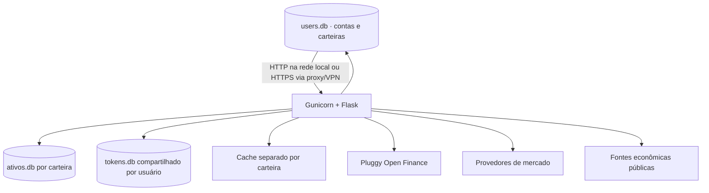

<div align="center">
  
  <h1>Lonely Wallet</h1>
  <p><strong>Gerenciador pessoal de carteira de investimentos, auto-hospedado em Docker.</strong></p>
  <p>
    <strong>Versão 6.1.17</strong> · Interface em português (Brasil) · Python/Flask · SQLite · Docker
  </p>
</div>

---

## Índice

- [Sobre o projeto](#sobre-o-projeto)
- [Principais recursos](#principais-recursos)
- [Uso em celulares e tablets](#uso-em-celulares-e-tablets)
- [Como os dados são obtidos](#como-os-dados-são-obtidos)
- [Arquitetura](#arquitetura)
- [Requisitos](#requisitos)
- [Instalação no ZimaOS/CasaOS](#instalação-no-zimaoscasaos)
- [Instalação com Docker Compose](#instalação-com-docker-compose)
- [Primeiro acesso, usuários e carteiras](#primeiro-acesso-usuários-e-carteiras)
- [Isolamento de dados por usuário e carteira](#isolamento-de-dados-por-usuário-e-carteira)
- [Guia de uso](#guia-de-uso)
  - [Resumo](#1-resumo)
  - [Proventos](#2-proventos)
  - [Patrimônio](#3-patrimônio)
  - [Lançamentos](#4-lançamentos)
  - [Importação da B3](#5-importação-da-b3)
  - [Distribuição da carteira](#6-distribuição-da-carteira)
  - [Integrações e APIs](#7-integrações-e-apis)
  - [Segurança](#8-segurança)
- [Configuração da Pluggy](#configuração-da-pluggy)
- [Provedores de dados](#provedores-de-dados)
- [Configurações do container](#configurações-do-container)
- [Arquivos e persistência](#arquivos-e-persistência)
- [Backup e restauração](#backup-e-restauração)
- [Atualização de versão](#atualização-de-versão)
- [Diagnóstico e solução de problemas](#diagnóstico-e-solução-de-problemas)
- [API HTTP interna](#api-http-interna)
- [Desenvolvimento e testes](#desenvolvimento-e-testes)
- [Limitações conhecidas e avisos](#limitações-conhecidas-e-avisos)
- [Privacidade e segurança operacional](#privacidade-e-segurança-operacional)
- [Licença](#licença)

---

## Uso em celulares e tablets

A interface web é responsiva e pode ser aberta pelo navegador do celular ou tablet usando o mesmo endereço do servidor. Não é necessário criar outra carteira nem sincronizar bancos separados.

### Navegação

- Em telas estreitas, a navegação principal fica em uma faixa horizontal. Deslize para os lados para acessar Resumo, Proventos, Patrimônio, Lançamentos, Distribuição, APIs e Segurança.
- O cabeçalho reduz o tamanho do logotipo e organiza os atalhos de privacidade, tema, importação B3 e novo lançamento em controles adequados ao toque.
- Os painéis e indicadores passam para uma ou duas colunas conforme a largura disponível.

### Tabelas

Algumas tabelas possuem mais colunas do que cabem em um celular. Para manter os números e títulos legíveis, a tabela conserva sua largura mínima e o contêiner permite deslizar horizontalmente. Isso não amplia a página inteira; somente a área da tabela se move.

### Gráficos e filtros

Gráficos, seletores de período, filtros de classe e ativo ocupam a largura disponível. Quando há vários controles, eles são reorganizados em linhas para evitar campos estreitos. Para gráficos com muitos períodos, mantenha o celular na orientação que ofereça melhor leitura.

### Formulários e diálogos

Formulários passam a uma coluna. Diálogos abrem próximos à parte inferior da tela e podem ser rolados independentemente, permitindo alcançar os botões mesmo quando o teclado virtual está aberto.

### Recomendações de uso

- Use um navegador atualizado (Chrome, Firefox, Edge ou Safari).
- Para acesso dentro de casa, abra o endereço local do ZimaOS pela mesma rede Wi-Fi.
- Para acesso externo, use uma VPN privada ou um proxy reverso com HTTPS válido. Não exponha diretamente a porta HTTP 8085 à internet.
- Em telas de 280 px ou mais, o layout reorganiza os principais componentes. A experiência final ainda depende do navegador, escala de fonte e tamanho real do dispositivo.

> A revisão responsiva foi verificada em larguras de referência de 280 px a 1.920 px, incluindo orientação retrato e paisagem. A validação automatizada não substitui o teste em aparelhos físicos e navegadores diferentes.

A revisão responsiva não substitui um aplicativo Android/iOS nativo. A interface mobile é a mesma aplicação web, ligada ao mesmo servidor e aos mesmos dados.

## Sobre o projeto

O **Lonely Wallet** é uma aplicação pessoal para registrar e acompanhar uma carteira de investimentos. Ela é executada no próprio servidor do usuário, normalmente em um equipamento com ZimaOS/CasaOS e Docker, e é acessada pelo navegador de um computador, tablet ou celular.

A aplicação reúne em uma única interface:

- posições e patrimônio por classe de ativo;
- compras, vendas e operações agendadas;
- proventos recebidos e eventos de pagamento anunciados;
- importação de movimentações por planilha Excel da B3;
- integração Open Finance com a Pluggy;
- fontes externas de cotações, histórico e indicadores econômicos;
- distribuição atual da carteira e percentuais-alvo;
- proteção de acesso por PIN.

O servidor local é a fonte central dos dados. Cada usuário entra com username + PIN; dentro da conta pode alternar entre até três carteiras. Os dados financeiros e as conexões bancárias Pluggy são isolados por carteira. As credenciais de APIs de mercado são compartilhadas entre as carteiras do mesmo usuário, mas não entre usuários. O mesmo usuário pode acessar suas carteiras em diferentes dispositivos, sem duplicar os dados.

### Destaques da versão 6.1.17
- Corrigido o contraste da identidade visual no tema claro. O cabeçalho, a tela de carregamento, o favicon e o ícone de toque agora alternam para variantes próprias com os elementos antes brancos em grafite escuro e o dourado original preservado.
- Ao voltar para o tema escuro, o aplicativo restaura automaticamente os assets originais com elementos claros.
- A troca de tema atualiza tanto o logotipo quanto o ícone do navegador e o ícone de atalho móvel; a mudança de página mantém o favicon correspondente ao tema atual.
- Não houve alteração no desenho da marca, nos dados financeiros, bancos SQLite, credenciais Pluggy ou formato do cache.

### Destaques da versão 6.1.16
- Removido da seção **Configurações → Gerenciar usuários** o parágrafo explicativo extenso sobre permissões Master/Admin/Usuário comum. As regras de autorização e as verificações no backend permanecem inalteradas.
- Corrigida a duplicação do botão **Adicionar lançamento** em telas móveis: a ação continua disponível no cabeçalho, enquanto o botão repetido dentro da página Resumo fica oculto até 760 px.
- O botão **Atualizar** do Resumo e o CTA de **Adicionar lançamento** no desktop permanecem preservados.
- Nenhuma alteração em bancos de dados, credenciais Pluggy, operações financeiras ou formato do cache.

### Destaques da versão 6.1.15
- Corrigido o seletor de carteiras em celulares: o menu agora é renderizado em uma camada global do documento, fora do cabeçalho e da navegação sticky, evitando que a barra de navegação corte ou cubra opções.
- O menu é posicionado em relação ao botão de carteira, respeita a largura e a altura visíveis do navegador e ganha rolagem interna quando o conteúdo não cabe na tela.
- O menu fecha com toque fora, tecla Escape ou rolagem da página; a seleção, criação, renomeação e exclusão de carteiras mantêm os mesmos fluxos e permissões.
- Nenhuma alteração nos bancos financeiros, credenciais Pluggy, tokens compartilhados ou formato do cache.

### Destaques da versão 6.1.14
### Correção visual da v6.1.14
- Removida do modal de gerenciamento de usuários a frase auxiliar sobre promoção/rebaixamento de permissões.
- Mantidas integralmente as regras de autorização no backend: somente o Master pode alterar o papel de outras contas.
- O seletor de permissão continua sendo exibido somente quando a sessão possui autorização para alterar o papel.

- Campos de PIN passaram a aceitar somente dígitos ASCII (`0–9`), com bloqueio de inserção não numérica e sanitização de colagens/autopreenchimento. O backend também rejeita algarismos Unicode e valida o mesmo conjunto ASCII nas rotas de login, cadastro e alteração de PIN. A regra cobre login, primeiro acesso, criação e edição de usuários, alteração de PIN e confirmações de exclusão.
- Padronizada a altura dos campos de texto e seletores nos formulários de Segurança e no diálogo de gerenciamento de usuários; rótulos reservam altura consistente para alinhar as caixas em duas colunas e reorganizam para uma coluna em telas estreitas.
- Corrigida uma condição de corrida no cache de histórico patrimonial: se uma carteira for removida enquanto um worker calcula o histórico, a gravação do snapshot é descartada sem recriar diretórios excluídos nem registrar falso alerta. Erros reais de permissão e de escrita continuam sendo registrados.
- Incluídos testes específicos para sanitização numérica, alinhamento dos formulários e descarte seguro de gravações de cache durante exclusões.
- A confirmação de exclusões de conta e usuários utiliza diálogos próprios do Lonely Wallet, compatíveis com os temas claro e escuro, no lugar dos prompts nativos do navegador.
- O botão **Sair** foi movido para o cabeçalho, ao lado de **Adicionar lançamento**, com rótulo simplificado e sem tooltip nativo.
- Adicionada exclusão de carteiras adicionais. A carteira Padrão é protegida e não pode ser removida; a exclusão exige o PIN atual, remove apenas os dados e cache daquela carteira e preserva as credenciais de APIs compartilhadas e as demais carteiras.
- Se a carteira excluída estiver selecionada, o aplicativo seleciona automaticamente outra carteira existente.
- O Admin pode listar usuários comuns, redefinir o PIN e excluir somente usuários comuns. Renomear contas, promover/rebaixar e gerenciar outras contas Admin continuam sendo ações exclusivas do Master.
- O painel de exclusão de conta foi harmonizado com as cores e superfícies do tema do projeto.

- Reforçada a unicidade dos nomes de usuário com índice único sobre `username_norm`, sem diferenciar maiúsculas/minúsculas; criação e alteração também verificam conflitos antes de gravar, mantendo a restrição do banco como proteção contra requisições simultâneas.
- Corrigida a abertura dos modais de criação e renomeação de carteiras: a classe `open` agora possui regra de exibição (`.modalback.open`), fazendo os formulários aparecerem corretamente. A correção também beneficia o modal de gerenciamento de usuários.
- Corrigido o visual do card Pluggy: a borda utiliza o mesmo token `--line` dos demais cards de APIs, sem contorno branco destacado ou sombra adicional.
- Formalizada a matriz de três papéis no código, na interface e na documentação: Master, Admin e Usuário comum.
- Master é a primeira conta cadastrada e única; ninguém pode gerenciar sua conta. Somente o próprio Master pode alterar username/PIN ou excluir a própria conta. Se houver outras contas, a conta restante mais antiga é promovida automaticamente a Master; se ele for o último usuário, a instalação é reiniciada.
- Admin cria somente usuários comuns, redefine PIN e exclui somente usuários comuns; não visualiza nem gerencia outros Admins ou o Master. Admin também pode apagar a própria conta.
- O endpoint de status não revela aos usuários comuns nem aos Admins a quantidade total de outras contas da instalação.
- Usuário comum pode redefinir seu próprio PIN e apagar a própria conta; não pode alterar username nem gerenciar outras contas.
- A exclusão de conta própria está disponível em Configurações para todos os papéis autenticados e remove os bancos, carteiras, tokens compartilhados por usuário, conexões Pluggy e caches vinculados à conta. Backups antigos não são reescritos automaticamente.
- Incluídas verificações de regressão para autoexclusão dos três papéis e preservação das contas não envolvidas.
- A inicialização reconcilia o papel Master com a primeira conta criada, mantém somente um Master e normaliza papéis antigos desconhecidos para Usuário comum. A proteção por índice e triggers é refeita em uma operação de savepoint para evitar uma migração parcial.
- A camada interna de criação também exige o contexto autenticado e a versão vigente da sessão do criador; a autorização é conferida novamente dentro da transação. Negativas de permissão retornam HTTP 403; excesso de cadastros por IP continua retornando HTTP 429.


- Corrigido o envio do formulário de criação/renomeação de carteiras: o evento `submit` agora chama o endpoint correto, valida a resposta padronizada e atualiza o seletor após salvar.
- A renomeação mantém a carteira selecionada e atualiza a identificação mostrada no cabeçalho.
- O cache temporário da autenticação Pluggy agora acompanha o usuário, não a carteira. A rotação das credenciais compartilhadas invalida o token temporário em todas as carteiras daquela pessoa, sem afetar outros usuários.
- As credenciais de APIs são compartilhadas entre as carteiras do mesmo usuário em um único cofre `tokens.db` por usuário. Os registros bancários Pluggy (`itemId`, contas, posições e transações) continuam isolados no `ativos.db` de cada carteira.
- Uma carteira adicional começa sem operações, posições, proventos, alvos de distribuição ou conexões bancárias Pluggy; ela reutiliza somente o cofre de tokens de API da mesma conta.
- O `DASHBOARD_CACHE_FORMAT` permanece em `28`; as alterações desta versão são de autorização de usuários e não exigem invalidar o cache financeiro.
- Mantidos o README detalhado na raiz do pacote, o layout responsivo, a remoção do painel visual de consumo das APIs e o selo **(Recomendado)** da Pluggy.

> **Importante:** o Lonely Wallet é uma ferramenta de organização e acompanhamento. Não é corretora, custodiante, instituição financeira, serviço de recomendação de investimentos ou sistema oficial de apuração tributária.


## Principais recursos

| Área | O que oferece |
|---|---|
| **Resumo** | Indicadores consolidados, evolução do patrimônio, alocação e grupos de ativos. |
| **Proventos** | Recebimentos confirmados, eventos anunciados, filtros por período, classe e ativo, histórico e distribuição. |
| **Patrimônio** | Evolução histórica e composição da carteira por classe. |
| **Lançamentos** | Cadastro, edição, exclusão e exportação de compras e vendas. |
| **Importação B3** | Prévia, importação e gerenciamento de lotes de planilhas `.xlsx` exportadas pela B3. |
| **Distribuição** | Definição de percentuais-alvo e comparação com a composição atual. |
| **Integrações e APIs** | Configuração de credenciais, provedores de mercado e conexões Pluggy. |
| **Segurança** | Usuários com username + PIN, cadastro controlado de contas, alteração de usuário/PIN e bloqueio da sessão. |
| **Carteiras personalizadas** | Até três carteiras por usuário, com dados financeiros e conexões bancárias Pluggy independentes; credenciais de API compartilhadas entre carteiras do mesmo usuário. |

### Classes de ativos

O cadastro de operações reconhece as seguintes classes: Ações, FIIs, ETFs, BDRs, ETFs Internacionais, Stocks, REITs, Criptomoedas, Renda Fixa, Tesouro Direto, Fundos de Investimentos e Outros.

A disponibilidade de cotação, histórico, indicadores e cálculo de saldo varia conforme a classe e os dados disponibilizados pelas fontes configuradas. A página **Proventos** é destinada a ativos com eventos de proventos elegíveis; títulos de renda fixa e Tesouro não são apresentados nessa página na versão 6.1.14.

## Como os dados são obtidos

O aplicativo combina dados informados pelo usuário com informações fornecidas por serviços externos:

1. **Lançamentos manuais:** compras e vendas registradas pelo usuário.
2. **Planilha B3:** operações e proventos identificados em uma planilha de movimentações exportada pelo investidor.
3. **Pluggy:** posições e movimentações de investimento retornadas pelas conexões autorizadas.
4. **Provedores de mercado:** cotações, séries históricas, eventos anunciados e indicadores, conforme a cobertura de cada serviço.
5. **Fontes públicas:** séries econômicas oficiais e dados abertos utilizados pelos cálculos que possuem integração implementada.

O aplicativo mantém cache de respostas e dados históricos para reduzir chamadas repetidas e melhorar o tempo de carregamento. Cache não transforma uma cotação antiga em cotação atual; confira a data de referência apresentada pela interface.

### Recebimentos e previsões de proventos

- Um evento anunciado por uma fonte de mercado é uma **previsão**, não um comprovante de crédito.
- A classificação de recebimento efetivo depende de uma movimentação de investimento Pluggy importada e conciliada com o evento correspondente.
- Uma data de pagamento passada, por si só, não confirma que o dinheiro foi recebido.
- Eventos não confirmados depois da data prevista deixam de participar da projeção exibida, mas os registros históricos permanecem armazenados para auditoria e conciliação.
- Valores futuros são estimativas calculadas com os dados do evento e a posição elegível na data-com. Podem divergir do valor efetivamente creditado.

## Arquitetura



- **Backend:** Python 3.12, Flask e Gunicorn com worker `gthread`.
- **Interface:** HTML, CSS e JavaScript servidos pelo próprio Flask.
- **Dados:** SQLite; registro central de usuários, um `ativos.db` por carteira e um cofre `tokens.db` por usuário. Os registros de conexão bancária Pluggy permanecem no `ativos.db` da carteira.
- **Execução:** container Docker com usuário de aplicação sem privilégios após a preparação inicial do volume.
- **Fuso padrão:** `America/Sao_Paulo`.
- **Gráficos:** Chart.js 4.6.1 quando o bundle local passa na verificação de integridade; caso contrário, o projeto inclui um renderer alternativo offline.

## Requisitos

### Para executar pelo pacote-fonte

- Docker Engine instalado e em execução.
- Docker Compose v2 (`docker compose`).
- Acesso ao diretório em que o projeto será instalado.
- Espaço em disco para os bancos SQLite, cache e backups.
- Conexão à internet para consultar provedores externos. A aplicação pode abrir sem que todas as APIs estejam disponíveis, mas os dados externos podem ficar incompletos ou desatualizados.

### Compatibilidade declarada pelo pacote

- O metadado de distribuição CasaOS/ZimaOS declara `amd64`.
- A imagem base do Dockerfile é `python:3.12-slim`.
- A configuração padrão reserva até 4 GB de memória e 1 CPU no bloco de recursos do Compose. A aplicação real deve ser dimensionada conforme o número de ativos, histórico, frequência de consulta e recursos do host.

## Instalação no ZimaOS/CasaOS

O pacote inclui `docker-compose.yml` com metadados `x-casaos` para a integração com interfaces compatíveis com CasaOS/ZimaOS.

### Instalação pelo projeto-fonte

1. Baixe e extraia o ZIP da versão desejada.
2. Coloque os arquivos do projeto em um diretório persistente, por exemplo `/DATA/AppData/lonely-wallet`.
3. Confirme que o `docker-compose.yml` está nesse diretório.
4. Crie o diretório persistente de dados:

   ```bash
   mkdir -p /DATA/AppData/lonely-wallet/data
   ```

5. Abra um terminal/SSH no servidor e entre na pasta do projeto:

   ```bash
   cd /DATA/AppData/lonely-wallet
   ```

6. Construa e inicie o container:

   ```bash
   docker compose up -d --build
   ```

7. Acompanhe a inicialização:

   ```bash
   docker compose logs -f --tail=100 lonely-wallet
   ```

8. No navegador de um dispositivo da mesma rede, acesse:

   ```text
   http://IP_DO_ZIMAOS:8085
   ```

   Substitua `IP_DO_ZIMAOS` pelo endereço IP do seu servidor.

### Instalação usando imagem já publicada

O Compose declara `lonker/lonely-wallet:latest` e também contém uma seção `build` para construção local. Se a intenção for usar exclusivamente uma imagem publicada, confirme primeiro que a tag desejada existe no registry e ajuste/remova a seção `build` conforme o método de implantação escolhido. Não presuma que `latest` corresponde a uma versão específica: para implantação reproduzível, prefira uma tag versionada publicada e verificada.

### Portas

| Origem no host | Porta no container | Uso |
|---:|---:|---|
| `8085` | `8080` | Interface web e API HTTP interna |

Se a porta `8085` já estiver ocupada, altere o lado esquerdo do mapeamento, por exemplo `8086:8080`, e atualize também o metadado `x-casaos.port_map`. Depois recrie o container.

## Instalação com Docker Compose

A configuração incluída no pacote utiliza, entre outros, os seguintes parâmetros:

```yaml
services:
  lonely-wallet:
    image: lonker/lonely-wallet:latest
    build:
      context: .
      dockerfile: Dockerfile
    container_name: lonely-wallet
    restart: unless-stopped
    network_mode: bridge
    ports:
      - "8085:8080"
    environment:
      BRAPI_TOKEN: ""
      BRAPI_MAX_TICKERS_PER_REQUEST: "1"
      BRAPI_REQUEST_GAP_SECONDS: "0.35"
      PLUGGY_REQUEST_GAP_SECONDS: "1.0"
      ASSETS_DB_PATH: /data/ativos.db
      TOKEN_DB_PATH: /data/tokens.db
      USER_DB_PATH: /data/users.db
      DB_PATH: /data/carteira.db
      TZ: America/Sao_Paulo
    volumes:
      - /DATA/AppData/lonely-wallet/data:/data
```

Use o arquivo completo distribuído no projeto. O trecho acima é apenas uma visualização dos parâmetros centrais, não substitui o Compose integral.

### Healthcheck

O container executa `/srv/scripts/healthcheck.py` a cada 30 segundos, com timeout de 5 segundos, três tentativas e período inicial de 40 segundos. O healthcheck consulta `http://127.0.0.1:8080/api/health` e verifica a disponibilidade da aplicação, dos bancos e do motor de gráficos.

Quando o Chart.js oficial não está disponível ou não passa na verificação, mas o renderer alternativo está operacional, a API pode informar `degraded`. Esse estado é diferente de `unhealthy`: a aplicação pode continuar utilizável, mas os gráficos estarão no modo alternativo.

## Primeiro acesso, usuários e carteiras

### Primeiro acesso após atualizar uma instalação antiga

A primeira pessoa que configurar a v6.1.14 torna-se o **Master da instalação** e recebe a carteira existente como **Padrão**. O banco atual `ativos.db` e o cofre legado `tokens.db` são associados a essa conta, preservando operações, proventos, posições, credenciais de API e conexões Pluggy legadas.

1. Abra o endereço do Lonely Wallet no navegador.
2. Na tela inicial, informe um username (3 a 24 caracteres) e crie um PIN de 6 a 12 números.
3. Confirme o PIN.
4. Se a instalação antiga tinha um PIN ativo, informe-o no campo **PIN antigo da instalação** para autorizar a associação dos dados existentes à primeira conta.
5. Conclua a configuração. A carteira anterior será exibida como **Padrão**.

Em uma instalação realmente nova, não há PIN antigo para informar.

### Hierarquia de permissões

| Papel | O que pode fazer | Limites |
|---|---|---|
| **Master** | Criar Usuários comuns e Admins; listar, renomear, redefinir PIN, promover/rebaixar e excluir qualquer conta não-Master; gerenciar seu próprio username e PIN; apagar a própria conta a qualquer momento. | É a primeira conta cadastrada e existe exatamente um Master. Nenhuma outra conta pode gerenciá-lo, redefinir seu PIN, alterar seu papel ou excluí-lo. Se houver outras contas quando o Master sair, a conta restante mais antiga é promovida automaticamente a Master; se for a última conta, a instalação é reiniciada. |
| **Admin** | Criar somente Usuários comuns; listar a própria conta e Usuários comuns; redefinir PIN e excluir Usuários comuns; alterar seu próprio username e PIN; apagar a própria conta. | Não pode criar Admins, visualizar outros Admins ou o Master, renomear outras contas, redefinir PIN de Admins, alterar papéis ou gerenciar outras contas Admin. |
| **Usuário comum** | Usar suas próprias carteiras e dados financeiros; redefinir o próprio PIN; apagar a própria conta. | Não pode criar, listar ou gerenciar outras contas nem alterar o próprio username. A autoexclusão remove somente seus dados; as demais contas permanecem intactas. |

O papel inicial é selecionado pelo **Master** (Usuário comum ou Admin) ou pelo **Admin** (somente Usuário comum) durante a criação. Depois que a conta existe, **somente o Master pode promover um Usuário comum a Admin ou rebaixar um Admin a Usuário comum**. O Admin pode criar, redefinir PIN e excluir exclusivamente Usuários comuns. Essas regras são aplicadas no backend, independentemente dos controles exibidos na interface.

### Exclusão da própria conta

- **Master com outras contas restantes:** pode excluir sua própria conta após confirmar o PIN e digitar `TRANSFERIR MASTER E EXCLUIR MINHA CONTA`. A conta restante mais antiga (`created_at`, com desempate pelo ID) é promovida automaticamente a Master dentro da mesma transação SQLite. O `auth_version` dessa conta é incrementado para invalidar a sessão antiga e exigir novo login. São removidos somente os dados, carteiras, tokens compartilhados entre as carteiras e caches do Master que saiu; as contas e os dados dos demais usuários permanecem preservados. Se o Master possuía a carteira legada, os bancos legados da raiz (`ativos.db`, `carteira.db`, `tokens.db` e cache legado, incluindo sidecars SQLite) também são colocados em quarentena e excluídos. As chaves globais necessárias aos usuários restantes são preservadas.
- **Master como último usuário:** pode excluir a própria conta com a confirmação `APAGAR TODA A INSTALAÇÃO`. Essa ação apaga os dados locais da instalação dentro do volume, preserva o schema vazio de `users.db` para o primeiro acesso e reinicia o cadastro do Master.
- A transferência de Master não compartilha nem transfere os dados financeiros do usuário que saiu. Backups anteriores continuam preservados; cópias da conta excluída dentro de arquivos de backup precisam ser eliminadas separadamente se essa for a intenção.
- **Admin:** pode apagar a própria conta e todos os dados vinculados a ela, sem afetar as demais contas.
- **Usuário comum:** pode apagar a própria conta e todos os dados vinculados a ela, sem afetar as demais contas.
- A exclusão exige o PIN atual e uma frase de confirmação explícita. Arquivos de backup antigos não são modificados automaticamente; se houver cópias da conta em backups, elas precisam ser tratadas separadamente conforme a política de retenção.
- A lista **Gerenciar usuários** mostra uma ação **Excluir** somente para contas que o papel atual tem autorização para excluir. O botão **Excluir minha conta** aparece na própria seção Configurações para todos os papéis autenticados.

### Transferência automática de Master na autoexclusão

A autoexclusão do Master é uma operação explícita e independente de exclusão de outros usuários:

1. O Master informa o PIN atual.
2. Quando há outras contas, deve digitar exatamente `TRANSFERIR MASTER E EXCLUIR MINHA CONTA`.
3. Dentro da transação de identidade, o sistema escolhe a conta mais antiga restante (`created_at`, depois `id`), remove a conta Master anterior e promove a escolhida.
4. A versão de autenticação do sucessor é incrementada. Ele precisa fazer login novamente para receber as permissões de Master.
5. Os bancos, tokens e caches exclusivos do Master que saiu são colocados em quarentena e excluídos; as carteiras e conexões das outras contas não são copiadas, alteradas ou removidas.
6. Chaves globais de criptografia e assinatura que os demais usuários ainda precisam são preservadas.

Se não houver outra conta, a frase de confirmação é `APAGAR TODA A INSTALAÇÃO` e o volume local é reiniciado para o primeiro acesso. A operação é recuperável: se o processo cair antes do commit da identidade, os arquivos em quarentena são restaurados; se cair após o commit, a inicialização conclui a exclusão. O marcador da conta removida permanece ativo durante o restante do processo atual para bloquear tarefas antigas em segundo plano; a rotina de recuperação o limpa na próxima inicialização. Se bancos legados do Master estiverem configurados fora de `/data`, a transferência é recusada de forma segura antes de apagar a conta; coloque esses bancos no volume de dados ou ajuste os caminhos para permitir a exclusão completa.

### Entrar e adicionar outras pessoas

Depois que o Master inicial estiver cadastrado:

- A tela de login solicita **nome de usuário + PIN**.
- Para adicionar outra pessoa, entre como Master ou Admin e abra **Configurações → Adicionar usuário**, informe username, PIN inicial, confirmação e o PIN atual do administrador.
- O Master pode escolher criar uma conta Usuário comum ou Admin. O Admin não recebe seletor de papel e cria somente contas Usuário comum.
- O usuário criado recebe uma carteira **Padrão** vazia, com banco financeiro próprio e um cofre de tokens de API próprio. Nenhuma conexão bancária Pluggy é copiada. As novas carteiras desse mesmo usuário compartilham esse cofre de credenciais, mas nunca os `itemId`, contas ou movimentações bancárias.
- Contas adicionais não recebem acesso aos dados de outras pessoas.
- Somente Master e Admin podem criar usuários. Master pode criar Usuários comuns e Admins; Admin pode criar somente Usuários comuns. O formulário não é renderizado para contas comuns. O endpoint `/api/auth/register` e a camada de persistência verificam novamente o papel do criador no servidor.
- O administrador não recebe automaticamente acesso ao conteúdo financeiro das carteiras dos demais usuários.

O Master e o Admin podem alterar seu próprio nome de usuário em **Configurações → Conta do usuário**, mediante confirmação do PIN atual. Todas as contas podem redefinir o próprio PIN na mesma página. O usuário comum não pode alterar seu username; somente o Master pode renomear outras contas. O Admin não exclui outras contas Admin nem o Master; o Master pode excluir Admins. Todos os usuários podem apagar a própria conta na seção **Configurações**. Quando o Master se autoexclui e existem outras contas, a conta mais antiga restante assume o papel Master e precisa entrar novamente; quando ele é o único usuário, a instalação é reiniciada. O PIN é obrigatório e não pode ser desativado.

### Isolamento de dados por usuário e carteira

- Cada usuário tem no máximo três carteiras. O cofre de credenciais dos provedores de API é único por usuário; dados bancários Pluggy não são compartilhados.
- A primeira é criada automaticamente com o nome **Padrão**. Seu nome pode ser alterado.
- As carteiras adicionais podem ter nome próprio, por exemplo `Aposentadoria` ou `Viagem`.
- Ao criar uma carteira, ela começa sem ativos, operações, proventos, posições, lotes B3 ou conexões bancárias Pluggy. Os tokens de API já cadastrados pelo mesmo usuário são reutilizados automaticamente; isso não compartilha os `itemId` nem os dados bancários de outra carteira.
- Cada carteira tem um banco de ativos e um cache de dashboard próprios. As credenciais de APIs de mercado ficam em um cofre compartilhado por todas as carteiras do mesmo usuário, mas isolado dos demais usuários. Os registros `pluggy_items`, contas, posições e transações ficam no banco financeiro de cada carteira.
- Na inicialização, o servidor percorre as carteiras registradas e aplica migrações de schema de forma idempotente em cada par de bancos; carteiras interrompidas durante a criação podem ser recuperadas com bancos vazios, sem copiar dados de outra conta.
- Ao alternar a carteira no seletor ao lado do logotipo, toda a interface passa a consultar a carteira selecionada. A seleção é lembrada no próximo login.
- A carteira Padrão não pode ser excluída. Carteiras adicionais podem ser removidas individualmente pelo seletor de carteiras, mediante confirmação do PIN atual. A operação remove os bancos financeiros e o cache exclusivos da carteira, mas preserva o cofre de credenciais de APIs compartilhado pelo usuário e as outras carteiras.

### Regras de autenticação

- Username: 3 a 24 caracteres; letras sem acento, números, ponto, hífen e sublinhado. A comparação não diferencia maiúsculas/minúsculas.
- PIN: 6 a 12 números.
- O hash do PIN usa PBKDF2-HMAC-SHA256 com salt aleatório.
- Após cinco tentativas incorretas recentes para a combinação de endereço IP e usuário, essa combinação fica temporariamente bloqueada por cinco minutos.
- Há também um limite global por endereço IP: vinte falhas em uma janela de quinze minutos bloqueiam novas tentativas por cinco minutos, mesmo que o visitante altere o nome de usuário entre as tentativas.
- As mesmas proteções persistentes são aplicadas às confirmações de PIN usadas para criar usuários e alterar username ou PIN.
- A criação de usuários adicionais tem limite de cinco tentativas por endereço IP a cada hora e exige sessão do administrador mais confirmação do PIN atual.
- O histórico técnico de tentativas é limpo após 24 horas; os bloqueios ainda dentro da janela permanecem ativos.
- A alteração do PIN exige PIN atual, novo PIN e confirmação do novo PIN; a confirmação é validada também no servidor.
- A sessão expira após 30 minutos sem atividade.
- A reinicialização do processo invalida sessões anteriores.
- Alterar username ou PIN incrementa a versão de autenticação e invalida outras sessões da mesma conta.
- A chave de assinatura de sessão é persistida em `/data/.lonely-wallet-session.key`.

O usuário e PIN não substituem VPN, HTTPS, controle de acesso do proxy, firewall ou proteção do próprio host. Para acesso remoto, use HTTPS válido ou VPN; não exponha a porta HTTP diretamente à internet.

## Guia de uso

### 1. Resumo

A página **Resumo** apresenta a visão consolidada da carteira:

- indicadores gerais de patrimônio e desempenho;
- gráfico de evolução do patrimônio;
- composição atual por classe de ativo;
- grupos de posições e seus detalhes;
- atalhos para atualizar valores e adicionar um lançamento.

Os filtros de período e classe ajudam a analisar recortes diferentes da carteira. Valores dependem da qualidade e disponibilidade das cotações, do histórico e dos dados importados. Uma posição sem histórico ou sem cotação disponível pode aparecer com cobertura parcial ou sem cálculo de algum indicador.

### 2. Proventos

A página **Proventos** reúne dividendos, juros sobre capital próprio (JCP), rendimentos e outros eventos elegíveis.

Principais áreas:

- **Resumo:** médias, totais e distribuição dos proventos, conforme o período exibido.
- **Evolução de Proventos:** visualização mensal ou anual com filtros por período, tipo de ativo e ticker.
- **Histórico mensal:** consolidação dos valores por mês e ano.
- **Meus proventos:** lista de eventos com tipo, status, data-com, data de pagamento, quantidade e valores.
- **Distribuição:** detalhamento por ativo ou classe.
- **Atualizar histórico:** solicita uma nova verificação dos eventos disponíveis, respeitando cache, limites e intervalos dos provedores.

#### Como interpretar os status

- **Recebido:** exige confirmação por movimentação de investimento Pluggy importada e conciliada com o evento.
- **A receber:** evento anunciado para hoje ou uma data futura, ainda sem confirmação de recebimento.
- **Vencido sem confirmação:** não continua sendo somado como previsão de recebimento depois da data esperada. O dado bruto pode permanecer no banco para histórico e auditoria.

Eventos futuros são estimativas. A quantidade usada no cálculo considera os dados de posição disponíveis para a data-com; confirme os valores finais nos comunicados da empresa/fundo, na corretora ou na B3.

**Renda Fixa e Tesouro Direto não são classes exibidas na página Proventos da versão 6.1.14.** A existência de juros ou rendimento contratual de um título não significa que ele seja um provento de renda variável nesta tela.

### 3. Patrimônio

A página **Patrimônio** mostra:

- evolução histórica do patrimônio;
- filtros por período e classe;
- distribuição atual do valor por classe;
- composição detalhada da carteira.

Renda fixa possui tratamento próprio. A estimativa de saldo pode depender do tipo de título, indexador, taxa contratada, datas e histórico do índice correspondente. Quando os dados necessários não existem ou não permitem estimar o valor, a interface pode apresentar aviso ou cálculo indisponível.

### 4. Lançamentos

A página **Lançamentos** concentra as operações registradas:

- compras e vendas;
- quantidade, preço unitário e custos;
- data da operação;
- operações executadas e operações agendadas;
- consolidação de aportes por período e classe;
- exportação dos lançamentos;
- gerenciamento e edição de operações.

Para criar uma operação, use **Adicionar lançamento**, selecione compra ou venda, classe, ativo, data, quantidade, preço e custos opcionais. Para renda fixa, o formulário apresenta informações específicas, como emissor, título, indexador, taxa, forma de remuneração, vencimento e liquidez.

#### Datas e execução

- Operações históricas são mantidas na data informada.
- Operações de renda fixa não dependem do calendário de pregão da B3.
- Operações de renda variável podem ser ajustadas ao próximo pregão conforme data, horário e calendário de feriados; operações futuras podem ficar agendadas.
- Uma venda que deixaria a posição negativa é rejeitada pela validação da aplicação.

Confira quantidade, preço, custos e data antes de salvar. Uma operação incorreta pode alterar posição, custo de aquisição, rentabilidade e projeções.

### 5. Importação da B3

A importação usa uma planilha de movimentações `.xlsx` exportada pelo próprio investidor na B3. Não é uma conexão autenticada automática à conta B3.

#### Procedimento

1. Acesse **Lançamentos**.
2. Clique em **Importar tabela da B3**.
3. Selecione a planilha Excel `.xlsx` exportada pela B3.
4. Clique em **Analisar planilha**.
5. Confira a prévia, a quantidade de novos registros e as duplicidades identificadas.
6. Confirme a importação somente depois de revisar os dados.
7. Consulte o resultado em Lançamentos e no histórico de proventos.

#### Estrutura esperada

A planilha deve conter cabeçalhos equivalentes a:

- `Entrada/Saída`
- `Data`
- `Movimentação`
- `Produto`
- `Quantidade`
- `Preço unitário`
- `Valor da operação`

A importação reconhece movimentações de compra/venda e eventos de rendimento, dividendos e JCP suportados pelo parser atual. Renda fixa não é importada por esse fluxo; cadastre títulos de renda fixa manualmente.

#### Limites e proteção

- Extensão aceita: `.xlsx`.
- Tamanho máximo do upload: 16 MB.
- Limite do parser: 200.000 linhas de dados e 64 colunas.
- Arquivos com macros não são aceitos.
- O conteúdo do XLSX é validado antes de ser processado.
- Duplicidades são verificadas por identificadores do arquivo e critérios semânticos.

O botão **Editar importações da B3** permite consultar lotes e excluir lotes recentes quando há vínculo seguro com os registros criados por eles. Importações legadas sem vínculo individual suficiente podem aparecer sem opção de exclusão. Isso evita apagar lançamentos manuais ou registros de outras importações por engano.

### 6. Distribuição da carteira

Na página **Distribuição**, defina o percentual ideal para cada classe. O aplicativo compara a composição atual com os percentuais-alvo e apresenta diferenças de alocação.

- Os percentuais-alvo são preferências de organização, não recomendações automáticas.
- A soma das metas é tratada pela própria interface.
- Salve as alterações para persistir a configuração.
- Alterar uma meta não compra, vende ou movimenta ativos.

### 7. Integrações e APIs

A página **Integrações e APIs** contém a Pluggy e os provedores de mercado/indicadores.

Na versão 6.1.14, permanece removido o painel visual de **Consumo das APIs** para simplificar a interface. O backend continua mantendo cache, intervalos, pausas e mecanismos de controle de requisições. A remoção do painel não desativa os provedores.

Para provedores que exigem credencial:

1. Crie/acessar a conta diretamente no serviço.
2. Obtenha a chave/token de API correspondente.
3. Cole a credencial no cartão do provedor.
4. Salve e, quando disponível, use **Testar conexão**.
5. Consulte a mensagem do próprio cartão para saber se a credencial foi aceita.

Não informe senha da corretora, senha bancária, código de autenticação ou código temporário nesta página. A Pluggy utiliza Client ID e Client Secret de API, não a senha do banco.

### 8. Segurança

Na página **Segurança** é possível:

- consultar o username da conta atual;
- Master pode criar Usuários comuns e Admins; Admin pode criar somente Usuários comuns;
- Master pode listar, renomear, redefinir PIN, promover/rebaixar e excluir contas não-Master;
- Admin pode listar, redefinir PIN e excluir somente Usuários comuns; não pode renomear outras contas nem gerenciar Admins ou o Master;
- alterar o próprio username (Master e Admin) e o próprio PIN;
- excluir a própria conta, respeitando o fluxo especial de transferência do Master;
- verificar que o PIN é obrigatório.

O botão **Sair** fica no cabeçalho, ao lado de **Adicionar lançamento**, para permitir o bloqueio imediato sem navegar até Configurações.

O bloqueio automático é aplicado após 30 minutos sem atividade. O PIN é sempre obrigatório.

## Configuração da Pluggy

A Pluggy é a integração Open Finance principal do Lonely Wallet. O fluxo atual utiliza credenciais de aplicação e o `itemId` de cada conexão MeuPluggy.

### Etapas de configuração

1. Crie/acesse sua conta no [Dashboard da Pluggy](https://dashboard.pluggy.ai/).
2. Obtenha o **Client ID** e o **Client Secret** da aplicação Pluggy.
3. Na página **Integrações e APIs**, abra o cartão Pluggy.
4. Informe Client ID e Client Secret e clique em **Salvar credenciais**.
5. Abra o [MeuPluggy](https://meu.pluggy.ai/) e conecte a instituição financeira seguindo o fluxo disponibilizado pela Pluggy.
6. No Dashboard/área de conexões, copie o `itemId` correspondente à conexão criada.
7. Volte ao Lonely Wallet, informe um nome para a conexão e cole o `itemId`.
8. Clique em **Adicionar conexão** e depois em **Sincronizar tudo**.
9. Confira o status, a quantidade de investimentos e as movimentações de investimento recebidas.

A disponibilidade de contas, posições, movimentações e histórico depende da instituição, do conector, das permissões concedidas, do produto Open Finance e do conteúdo efetivamente retornado pela Pluggy.

### Sincronização automática

No botão **Gerenciar API**, escolha a frequência:

| Opção | Comportamento |
|---:|---|
| `0` | Desativada |
| `15` | A cada 15 minutos |
| `30` | A cada 30 minutos |
| `60` | A cada hora |
| `240` | A cada 4 horas (padrão) |
| `720` | A cada 12 horas |
| `1440` | Uma vez ao dia |

A frequência fica gravada no SQLite e é executada no servidor; não depende de manter a página do navegador aberta. Sincronizações manuais podem ser iniciadas pelo botão **Sincronizar tudo** ou pelo botão individual de cada conexão.

### Importante: a Pluggy não atualiza os dados em tempo real

A atualização dos dados depende de etapas diferentes, que não acontecem necessariamente no mesmo instante:

1. **Instituição financeira → Pluggy:** o banco ou a corretora precisa disponibilizar os dados e a conexão da Pluggy precisa ser atualizada. A Pluggy informa que novas transações não ficam disponíveis em tempo real; elas só podem ser consultadas depois que a conexão é atualizada. Em conectores Open Finance regulados, novas transações podem levar até **24 horas** para ficarem disponíveis, conforme a documentação da Pluggy ([FAQ oficial](https://v2.docs.pluggy.ai/pt/docs/get-started/faq)).
2. **Pluggy → Lonely Wallet:** depois que os dados já estiverem disponíveis na Pluggy, o Lonely Wallet precisa consultar a API e importar as informações para o banco local.

**O que o botão “Sincronizar” faz nesta versão:** consulta novamente os dados que já estão disponíveis na API Pluggy e atualiza a cópia local do Lonely Wallet. A sincronização manual ignora o intervalo mínimo da última consulta local, mas não força uma nova coleta na instituição financeira nem inicia a atualização manual do Item na Pluggy. Na implementação atual, essa rotina lê o Item, os investimentos e suas movimentações pela API; não executa a operação de atualização do Item na Pluggy. Portanto, clicar repetidamente em **Sincronizar tudo** não faz o banco liberar os dados mais rápido.

A frequência configurada em **Gerenciar API** (240 minutos por padrão) controla de quanto em quanto tempo o Lonely Wallet consulta novamente a Pluggy. Ela **não** é uma garantia de atualização da instituição nesse mesmo intervalo e não altera a agenda de atualização própria da Pluggy. A atualização de um Item pela Pluggy possui seu próprio processamento e pode passar por estados como `UPDATING` até chegar a `UPDATED` ([ciclo de vida do Item](https://docs.pluggy.ai/pt/docs/connections/item-lifecycle)).

**Quando uma movimentação recente não aparecer:** confira a última atualização e o status da conexão no MeuPluggy/Dashboard da Pluggy; aguarde a instituição e a Pluggy disponibilizarem a movimentação; depois execute **Sincronizar** ou **Sincronizar tudo** no Lonely Wallet. Se a conexão já estiver `UPDATED`, mas os dados continuarem ausentes, verifique o consentimento, a cobertura do conector e os logs do container.

### Limpar dados versus remover conexão

- **Limpar dados importados:** remove dados importados vinculados à conexão selecionada, incluindo snapshots, transações e operações que foram criadas exclusivamente por aquela conexão. Operações manuais ou apenas conciliadas com dados existentes são preservadas. A conexão e as credenciais permanecem cadastradas.
- **Remover:** desativa a conexão no Lonely Wallet. A ação de remoção não equivale ao botão de limpar dados importados.

Antes de limpar dados ou remover conexões, faça backup. A exclusão de dados importados pode alterar posições, histórico e conciliações.

As credenciais Client ID/Secret são armazenadas criptografadas no servidor. A chave utilizada para criptografia fica no volume persistente; perder essa chave pode impedir a leitura das credenciais já armazenadas.

## Provedores de dados

A lista abaixo descreve o papel dos serviços conforme o catálogo e as chamadas existentes no código da versão 6.1.14. A presença de um serviço na página não significa cobertura integral de todos os ativos ou endpoints.

| Provedor | Credencial | Utilização/observações |
|---|---|---|
| **Pluggy** | Client ID + Client Secret e `itemId` das conexões | Open Finance, posições e movimentações de investimento. A cobertura depende da instituição e do consentimento. |
| **brapi** | Token opcional conforme plano/uso | Cotações, histórico e eventos de proventos para ativos cobertos. O limite e a cobertura dependem do serviço/plano. |
| **HG Brasil** | Token | Cotações, dados de mercado e séries históricas conforme o plano e endpoints disponíveis. |
| **FRED** | API key | Séries macroeconômicas internacionais. Não substitui a cotação de ações brasileiras. |
| **Dados B3 · Índices históricos** | API key do serviço | Séries de índices como IBOV, IFIX, SMLL e IDIV; serviço independente, não é a API oficial da B3. |
| **Banco Central · SGS** | Não exige token | Séries oficiais como CDI, Selic e outros indicadores usados em cálculos e comparações. |
| **IBGE · SIDRA** | Não exige token | Séries estatísticas e indicadores econômicos, incluindo dados de inflação utilizados em comparações. |
| **Yahoo Finance** | Não exige token | Fonte complementar por endpoints não oficiais; pode mudar, limitar ou bloquear acesso sem aviso. |
| **Tesouro Transparente** | Não exige token no catálogo | Link para dados públicos do Tesouro Direto. A presença no catálogo não significa que todos os dados sejam usados automaticamente em cada cálculo. |
| **CVM Dados Abertos** | Não exige token no catálogo | Link para conjuntos públicos de fundos e demonstrações. Não é fonte de cotação em tempo real. |
| **B3 · APIs oficiais** | Exige contratação/licença e autorização conforme o produto | O cartão apresenta o serviço oficial e sua documentação. A importação de movimentações suportada pelo aplicativo é feita por planilha `.xlsx`, não por login direto na conta B3. |

### Limites, cache e disponibilidade

- Serviços externos podem limitar requisições, alterar endpoints ou ficar indisponíveis.
- O aplicativo respeita intervalos mínimos internos e mecanismos de espera/repetição quando a resposta do provedor informa pausa (por exemplo, `Retry-After`).
- Respostas em cache podem ser reutilizadas para reduzir chamadas.
- Uma credencial válida não garante que todos os tickers, históricos ou eventos estejam cobertos pelo plano contratado.
- Não cadastre senhas pessoais de serviços externos; utilize apenas chaves de API próprias.

## Configurações do container

O Compose fornecido define os parâmetros abaixo. A maioria dos usuários não precisa alterá-los.

| Variável | Padrão no pacote | Finalidade |
|---|---|---|
| `ASSETS_DB_PATH` | `/data/ativos.db` | Banco principal da carteira, operações, proventos e posições. |
| `TOKEN_DB_PATH` | `/data/tokens.db` | Caminho do cofre de API legado usado pelo primeiro usuário migrado. Para outros usuários, o servidor deriva um `tokens.db` por usuário. Todas as carteiras do mesmo usuário reutilizam o mesmo cofre. |
| `USER_DB_PATH` | `/data/users.db` | Registro central de usuários, usernames, hashes de PIN, papéis e carteiras associadas. |
| `DB_PATH` | `/data/carteira.db` | Caminho legado usado na migração inicial para o banco atual, quando aplicável. |
| `DATA_DIR` | `/data` | Diretório persistente usado pelos scripts do container. |
| `TZ` | `America/Sao_Paulo` | Fuso horário da aplicação e dos registros. |
| `BRAPI_TOKEN` | vazio | Token opcional da brapi; pode ser cadastrado pela interface. |
| `BRAPI_API_KEY` | vazio | Nome alternativo aceito pelo backend para o token brapi. |
| `BRAPI_MAX_TICKERS_PER_REQUEST` | `1` | Limite de tickers por requisição em chamadas que agrupam símbolos. |
| `BRAPI_REQUEST_GAP_SECONDS` | `0.35` | Intervalo interno entre requisições brapi, em segundos. |
| `PLUGGY_REQUEST_GAP_SECONDS` | `1.0` | Intervalo interno entre requisições Pluggy, em segundos. |
| `API_KEYS_KEY_FILE` | `/data/.api-credentials.key` | Chave Fernet que cifra credenciais de API. |
| `SESSION_SECRET_FILE` | `/data/.lonely-wallet-session.key` | Chave persistente de assinatura de sessão Flask. |
| `SESSION_COOKIE_SECURE` | `0` | Quando `1`, marca o cookie de sessão como `Secure`; use somente com acesso HTTPS configurado. |
| `QUOTE_HISTORY_PATH` | `/data/quotes_last_valid.json` | Arquivo auxiliar de cotações válidas anteriores. |
| `DASHBOARD_CACHE_PATH` | `SGS_CACHE_PATH` | `/data/sgs_cache.json` | Cache local de séries SGS. |

### Atenção ao HTTPS e cookies

Se a aplicação estiver atrás de um proxy reverso com HTTPS válido, pode-se configurar `SESSION_COOKIE_SECURE=1`. Não habilite essa opção enquanto continuar acessando somente por HTTP, pois o navegador não enviará o cookie marcado como seguro em uma conexão HTTP comum.

## Arquivos e persistência

**Regra de compartilhamento:** tokens de provedores (como brapi, HG Brasil e Client ID/Secret da Pluggy) são compartilhados entre carteiras do mesmo usuário. Já conexões bancárias, `itemId`, contas, posições, investimentos e movimentações Pluggy não são compartilhados entre carteiras. Usuários diferentes nunca compartilham o cofre de tokens.

O volume `/data` é obrigatório para preservar a carteira entre recriações do container.

| Caminho no volume | Conteúdo |
|---|---|
| `/data/users.db` | Registro central de usuários, hashes de PIN, papel de administrador e relação de carteiras. |
| `/data/ativos.db` | Banco da carteira **Padrão** legada: operações, ativos, proventos, lotes B3, snapshots e configurações. |
| `/data/tokens.db` | Cofre compartilhado de tokens de API do primeiro usuário migrado, preservado no caminho legado. |
| `/data/users/<user_id>/wallets/<wallet_id>/ativos.db` | Banco financeiro de cada carteira adicional ou de novos usuários. |
| `/data/users/<user_id>/tokens.db` | Cofre compartilhado de credenciais de API de todas as carteiras daquele usuário; não é compartilhado com outros usuários. |
| `/data/users/<user_id>/wallets/<wallet_id>/tokens.db` | Arquivo legado das versões 6.0.0; se existir, suas credenciais são mescladas no cofre do usuário considerando `updated_at`. O arquivo antigo é preservado para recuperação, mas não é mais usado em operação normal. |
| `/data/cache/<user_id>/<wallet_id>/dashboard_cache.json` | Snapshot de dashboard isolado por usuário e carteira. |
| `/data/carteira.db` | Banco legado que pode ser usado como origem na migração inicial, se o banco novo ainda não existir. |
| `/data/.api-credentials.key` | Chave necessária para decifrar credenciais de API armazenadas em `tokens.db`. |
| `/data/.lonely-wallet-session.key` | Chave de assinatura das sessões Flask. |
| `/data/quotes_last_valid.json` | Últimas cotações válidas armazenadas localmente. |
| `/data/sgs_cache.json` | Cache de séries econômicas SGS. |
| `/data/backups/` | Diretório usado pela aplicação para backups preventivos antes de determinadas exclusões. O script `backup.py` usa `/backup` como destino padrão, mas aceita outro diretório pelo argumento `--destination`. |

A aplicação mantém `/data/users.db` como registro de contas e associa cada conta a até três carteiras. Cada carteira possui seu próprio `ativos.db` e cache de dashboard. Os tokens de API ficam em um `tokens.db` por usuário: a conta principal migrada usa `/data/tokens.db` para preservar credenciais legadas; os demais usuários usam `/data/users/<user_id>/tokens.db`. As conexões bancárias Pluggy (`pluggy_items`, `pluggy_accounts`, `pluggy_investments`, `pluggy_transactions` e `pluggy_investment_transactions`) ficam no `ativos.db` individual de cada carteira. O token Client ID/Secret pode ser reutilizado para conectar outra instituição em outra carteira, mas cada carteira precisa cadastrar seu próprio `itemId`. A carteira padrão do primeiro usuário é uma associação dos bancos existentes para preservar dados; os demais diretórios financeiros são criados vazios. O banco legado `/data/carteira.db` pode ser migrado para `/data/ativos.db` pelo mecanismo de backup do SQLite. Não renomeie, apague ou misture esses arquivos manualmente.

O entrypoint prepara permissões do volume e depois executa a aplicação com usuário sem privilégios (UID/GID `10001`, usuário `app`). A migração de permissões é marcada por `.lonely-wallet-permissions-v1`. Se a preparação do volume falhar, o container deve interromper a inicialização em vez de prosseguir com permissões incertas.

## Backup e restauração

> **Faça backup antes de atualizar, importar grandes lotes, limpar dados Pluggy ou executar exclusões em massa.**

### Backup completo recomendado (no host ZimaOS)

O backup do diretório inteiro preserva `users.db`, todos os bancos de todas as carteiras, chaves ocultas, credenciais, configurações e caches. Execute no host:

```bash
# Pare o serviço para obter uma cópia consistente de todos os arquivos.
docker compose stop lonely-wallet

mkdir -p /DATA/Backups

tar -czf "/DATA/Backups/lonely-wallet-data-$(date +%F-%H%M).tar.gz" \
  -C /DATA/AppData/lonely-wallet data

# Inicie novamente depois de concluir a cópia.
docker compose start lonely-wallet
```

Guarde uma segunda cópia em outro dispositivo ou local de armazenamento. Um backup localizado somente no mesmo disco do servidor não protege contra falha física desse disco.

### Backup usando o script incluído

O projeto também inclui `/srv/scripts/backup.py`, que cria cópias consistentes de **todos os bancos SQLite encontrados no volume**, incluindo `users.db`, todos os bancos `ativos.db` das carteiras e o cofre `tokens.db` de cada usuário, por meio da API de backup do SQLite. Cada cópia passa por `PRAGMA integrity_check`; diretórios e arquivos do backup recebem permissões restritas. O destino padrão é `/backup`; monte esse caminho em um volume persistente ou informe outro diretório. As pastas `backups/`, `cache/` e `__pycache__/` não são percorridas como fonte de bancos.

Exemplo dentro do container, gravando no próprio volume de dados:

```bash
docker exec lonely-wallet python /srv/scripts/backup.py \
  --destination /data/backups --include-keys
```

O script, por padrão, não inclui as chaves de criptografia/sessão. A opção `--include-keys` inclui `.api-credentials.key` e `.lonely-wallet-session.key` dentro de uma pasta `secrets/` com permissões restritas. Guarde essa pasta junto do mesmo backup dos bancos, pois todas as carteiras usam a chave Fernet da instalação para decifrar suas credenciais. Como essas chaves dão acesso a dados sensíveis, proteja o backup e não o compartilhe. Prefira também copiar o resultado para outro dispositivo.

### Restauração

1. Pare o container.
2. Preserve uma cópia do diretório atual antes de substituir qualquer coisa.
3. Restaure o conteúdo completo do diretório `data` do backup para `/DATA/AppData/lonely-wallet/data`.
4. Se o backup inclui chaves, restaure as chaves correspondentes junto dos bancos. Não misture um `tokens.db` de uma instalação com a chave de outra.
5. Inicie o serviço e confira os logs e o healthcheck.

Exemplo de restauração a partir de um arquivo criado pelo comando `tar` acima:

```bash
docker compose stop lonely-wallet

# Faça uma cópia de segurança do estado atual antes de restaurar.
mv /DATA/AppData/lonely-wallet/data \
   "/DATA/AppData/lonely-wallet/data-before-restore-$(date +%F-%H%M)"

mkdir -p /DATA/AppData/lonely-wallet

tar -xzf /DATA/Backups/ARQUIVO-DE-BACKUP.tar.gz \
  -C /DATA/AppData/lonely-wallet

docker compose start lonely-wallet
```

O arquivo compactado deve conter a pasta `data/` na raiz do arquivo, conforme o comando de backup apresentado.

### Perda de arquivos de autenticação ou chaves

Se `/data/users.db` for perdido, as contas, usernames, hashes de PIN e associações das carteiras deixam de existir. Restaure-o somente junto do backup completo correspondente. Se `.api-credentials.key` for perdida, as credenciais criptografadas em cada `tokens.db` podem deixar de ser decifráveis. Restaure a chave correta do mesmo backup ou cadastre novamente as credenciais. Não apague esses arquivos para tentar resolver uma falha de login/API.

## Atualização de versão

1. Identifique o diretório do projeto e confirme que o serviço se chama `lonely-wallet`.
2. Faça um backup completo de `/DATA/AppData/lonely-wallet/data`.
3. Baixe a nova versão do projeto.
4. Atualize os arquivos de aplicação/Compose sem substituir nem apagar o diretório persistente `data/`.
5. No diretório do Compose, execute:

   ```bash
   docker compose up -d --build
   ```

6. Confira a inicialização:

   ```bash
   docker compose logs -f --tail=100 lonely-wallet
   ```

7. Verifique a saúde:

   ```bash
   docker inspect --format='{{.State.Health.Status}}' lonely-wallet
   ```

8. Acesse a interface e confira Resumo, posições, Lançamentos, Proventos e Integrações.

**Não execute `docker compose down -v` como procedimento de atualização.** Não apague o diretório de dados, não recrie os bancos e não remova as chaves de criptografia/sessão.

Se a instalação foi criada por um catálogo de aplicativos, use o mecanismo de atualização do próprio catálogo quando a imagem/versionamento forem publicados por esse canal. O ZIP-fonte não atualiza automaticamente a imagem remota do registry.

## Diagnóstico e solução de problemas

### 1. O container não inicia ou entra em reinicialização

Consulte os logs:

```bash
docker compose logs --tail=200 lonely-wallet
```

Confirme se a porta do host está livre e se `/DATA/AppData/lonely-wallet/data` é gravável. Erros de preparação de permissões devem ser corrigidos no volume/host; não ignore o erro nem remova o marcador de migração sem entender o estado dos arquivos.

### 2. A página não abre

Verifique se o container está em execução:

```bash
docker compose ps
```

Teste o endpoint local no host:

```bash
curl -i http://127.0.0.1:8085/api/health
```

Na rede local, confira o IP do ZimaOS, a porta `8085`, o firewall e o mapeamento `8085:8080`.

### 3. Healthcheck `healthy`, `degraded` ou `unhealthy`

Execute:

```bash
docker exec lonely-wallet python /srv/scripts/healthcheck.py
```

Ou consulte:

```bash
curl -s http://127.0.0.1:8085/api/health
```

- `healthy`: aplicação e recursos de gráficos verificados.
- `degraded`: aplicação utilizável, mas Chart.js oficial indisponível/sem integridade válida; o renderer alternativo pode estar ativo.
- `unhealthy`: aplicação, bancos ou renderizador necessário indisponível. Consulte logs.

O healthcheck do container aceita o modo `degraded` somente quando o renderer alternativo é identificado como disponível.

### 4. O PIN é solicitado novamente

Isso é esperado após reiniciar o processo ou o container, pois as sessões anteriores são invalidadas. Se o PIN estiver ativo, informe-o novamente. Caso o PIN tenha sido perdido, não apague `tokens.db` ou as chaves; isso pode destruir credenciais e configuração de acesso.

### 5. Uma API não retorna dados

Confira:

- se o token/Client ID/Client Secret foi salvo e está ativo;
- se o plano do provedor permite o endpoint consultado;
- se o ticker está coberto;
- se a instituição Pluggy concedeu o consentimento e ainda mantém a conexão válida;
- se o serviço externo está fora do ar ou limitou requisições.

Use **Testar conexão** quando disponível e consulte os logs do container. Uma chave válida não garante cobertura completa.

### 6. Pluggy não atualiza investimentos

1. Verifique Client ID e Client Secret.
2. Confira se a conexão MeuPluggy existe e se o `itemId` foi copiado corretamente.
3. Confira o status, o consentimento e a data da última atualização da conexão no MeuPluggy/Dashboard da Pluggy.
4. Lembre-se de que o botão **Sincronizar** do Lonely Wallet apenas consulta os dados já disponíveis na Pluggy; ele não força uma nova coleta no banco ou na corretora.
5. Quando a conexão da Pluggy estiver atualizada e os dados estiverem disponíveis, execute **Sincronizar** na conexão ou **Sincronizar tudo** no Lonely Wallet.
6. Confira a última sincronização local, a quantidade de investimentos e as movimentações exibidas no cartão.
7. Se necessário, consulte os logs do container.

Novas transações não são disponibilizadas em tempo real pela Pluggy. Em conectores Open Finance regulados, a própria Pluggy informa que a disponibilização pode levar até 24 horas. Uma conexão pode autenticar corretamente e ainda retornar poucos dados ou nenhum investimento, dependendo do produto, instituição, consentimento, atualização da conexão e histórico disponibilizado. Consulte também a seção [Importante: a Pluggy não atualiza os dados em tempo real](#importante-a-pluggy-não-atualiza-os-dados-em-tempo-real).

### 7. Proventos não aparecem ou não são marcados como recebidos

- Confirme se o ativo está em posição elegível e se a fonte de mercado publicou o evento.
- Verifique data-com, data de pagamento, ticker e valor.
- Para aparecer como **Recebido**, é necessária movimentação de investimento Pluggy elegível e conciliada. A data de pagamento passada ou o status de uma fonte de calendário não substituem essa confirmação.
- Eventos vencidos sem confirmação são removidos da projeção, mas podem continuar preservados no banco.
- Consulte comunicados do emissor e extrato da corretora para confirmar o crédito real.

### 8. Renda fixa sem saldo calculado

Confira se o lançamento possui emissor, tipo de título, indexador, taxa/percentual, forma de remuneração e vencimento quando aplicáveis. A ausência de dados contratuais ou de uma série histórica compatível pode impedir o cálculo. Não invente indexador ou taxa para preencher um campo obrigatório.

### 9. Importação B3 recusada

- Use a planilha `.xlsx` exportada pela B3.
- Confira os cabeçalhos e se a planilha ativa contém as colunas exigidas.
- Remova macros e salve novamente como `.xlsx`.
- Confira o limite de 16 MB, 200.000 linhas e 64 colunas.
- Analise a prévia antes de confirmar.

### 10. Credenciais deixaram de funcionar depois de restaurar um backup

A causa possível é incompatibilidade entre um ou mais cofres `tokens.db` e `.api-credentials.key`. Restaure o diretório de dados completo do mesmo backup ou recadastre as credenciais no cofre do usuário correspondente. Não gere manualmente uma nova chave com bancos antigos e espere que os segredos sejam decifrados.

### 11. Uma carteira está vazia ou não mostra conexões Pluggy

Confira o username no menu ao lado do logotipo e o nome da carteira selecionada. Os ativos e os bancos conectados via Pluggy são exclusivos de cada carteira. Uma carteira recém-criada começa sem operações, ativos ou conexões bancárias; é necessário cadastrar/importar dados e adicionar seus próprios `itemId` do MeuPluggy. Os tokens de API são reaproveitados automaticamente entre carteiras do mesmo usuário, mas os `itemId`, contas e movimentações Pluggy não são copiados.

### 12. Outro usuário não enxerga os dados da carteira

Isso é o comportamento esperado. Cada usuário acessa apenas suas próprias carteiras. O administrador pode criar contas adicionais em **Configurações → Adicionar usuário**; entregue à pessoa o username e o PIN inicial que foram cadastrados. Não compartilhe o mesmo login quando a intenção for manter dados separados.

## API HTTP interna

O frontend utiliza endpoints HTTP do próprio Flask. Os endpoints abaixo são referências internas da versão 6.1.14, não uma promessa de API pública estável para integrações de terceiros.

| Endpoint | Métodos | Finalidade |
|---|---|---|
| `/api/health` | GET | Estado da aplicação, bancos, versão e motor de gráficos. |
| `/api/auth/status` | GET | Estado da autenticação, usuário atual, papel e carteira selecionada. |
| `/api/auth/setup` | POST | Criar a primeira conta (username + PIN) e associar a carteira legada. |
| `/api/auth/login` | POST | Autenticar por username + PIN. |
| `/api/auth/logout` | POST | Encerrar sessão. |
| `/api/auth/register` | POST | Criar usuário adicional; exige sessão de administrador e confirmação do PIN atual. |
| `/api/auth/change-username` | POST | Alterar username com confirmação do PIN atual. |
| `/api/auth/change-pin` | POST | Alterar PIN da conta atual. |
| `/api/wallets` | GET, POST | Listar ou criar carteiras do usuário atual (máximo de três). |
| `/api/wallets/<wallet_id>/rename` | PUT | Renomear uma carteira pertencente ao usuário autenticado. |
| `/api/wallets/<wallet_id>/select` | POST | Selecionar uma carteira pertencente ao usuário autenticado. |
| `/api/dashboard` | GET | Dados consolidados do dashboard. |
| `/api/carteira` | GET | Posições e indicadores da carteira. |
| `/api/operacoes` | GET, POST | Consultar e cadastrar operações. |
| `/api/operacoes/<id>` | PUT, DELETE | Editar ou excluir operação. |
| `/api/operacoes/exportar` | GET | Exportar lançamentos. |
| `/api/importar-b3` | POST | Analisar/importar planilha B3. |
| `/api/importar-b3/lotes` | GET | Listar lotes de importação. |
| `/api/importar-b3/lotes/<lote_id>` | DELETE | Excluir lote com vínculo seguro. |
| `/api/proventos` | GET, POST | Consultar ou registrar provento manual. |
| `/api/proventos/sincronizar` | POST | Solicitar atualização de eventos de proventos. |
| `/api/proventos/sincronizar/status` | GET | Consultar status da sincronização em segundo plano. |
| `/api/pluggy/state` | GET | Consultar conexões e dados Pluggy. |
| `/api/pluggy/items` | POST | Cadastrar `itemId`. |
| `/api/pluggy/sync` | POST | Sincronizar dados Pluggy. |
| `/api/pluggy/settings` | GET, POST | Consultar/alterar frequência de sincronização. |
| `/api/integracoes` | GET | Listar provedores e estado das credenciais. |
| `/api/integracoes/<provider>` | POST, DELETE | Salvar ou remover credencial de provedor. |
| `/api/integracoes/<provider>/test` | POST | Testar credencial/conexão quando implementado. |
| `/api/distribuicao` | GET, PUT | Consultar/salvar alocação-alvo. |
| `/api/benchmarks` | GET | Dados de comparação com indicadores. |
| `/api/performance-history` | GET | Consultar processamento do histórico de rentabilidade. |
| `/api/ativos/busca` | GET | Buscar ativos. |

Todos os endpoints de dados exigem sessão autenticada por username + PIN, exceto login/setup, arquivos estáticos e healthcheck. O registro de usuários exige sessão do administrador e confirmação do PIN. Os endpoints de carteira verificam a propriedade do `wallet_id` no servidor; alterar IDs manualmente não permite consultar a carteira de outra pessoa. Requisições de escrita também passam pela verificação de origem implementada pelo backend.

Para obter o contrato exato de parâmetros e respostas, consulte as funções de rota em `app/main.py` e o frontend em `app/templates/index.html`. Não exponha esses endpoints diretamente na internet sem VPN/proxy seguro.

## Desenvolvimento e testes

### Estrutura do projeto

```text
.
├── app/
│   ├── main.py                  # Backend Flask, autenticação, carteiras, cálculos e integrações
│   ├── templates/
│   │   ├── index.html           # Interface principal, seletor de carteiras e Segurança
│   │   └── auth.html            # Login username + PIN e configuração inicial
│   └── static/
│       ├── lonely-wallet-logo.png
│       ├── lonely-wallet-logo-light.png
│       ├── lonely-wallet-logotype.png
│       ├── lonely-wallet-logotype-light.png
│       ├── lonely-wallet-favicon.png
│       └── lonely-wallet-favicon-light.png
│       └── vendor/
│           ├── chart-fallback.js
│           └── chartjs-build-status.json
├── scripts/
│   ├── entrypoint.py            # Preparação de permissões e redução de privilégios
│   ├── healthcheck.py           # Verificação de saúde do container
│   ├── backup.py                # Backup consistente dos bancos SQLite
│   └── vendor_chartjs.py        # Download e validação do Chart.js no build
├── tests/                       # Testes Python e JavaScript
├── Dockerfile
├── docker-compose.yml
├── requirements.txt
├── VERSION
└── README.md
```

### Tecnologias

- Python 3.12.
- Flask 3.1.3.
- Gunicorn 27.0.1 com worker `gthread`.
- SQLite.
- Requests para serviços HTTP.
- OpenPyXL para leitura/escrita de planilhas.
- `defusedxml` para proteção do processamento XML de arquivos XLSX.
- `cryptography`/Fernet para credenciais criptografadas.
- HTML, CSS e JavaScript no frontend.

As dependências Python estão fixadas em `requirements.txt`.

### Executar localmente para desenvolvimento

Com Python 3.12 disponível:

```bash
python -m venv .venv
source .venv/bin/activate       # Linux/macOS
# .venv\Scripts\activate      # Windows

pip install -r requirements.txt
```

Para iniciar localmente a partir da raiz do projeto:

```bash
ASSETS_DB_PATH=./dev-data/ativos.db \
TOKEN_DB_PATH=./dev-data/tokens.db \
DB_PATH=./dev-data/carteira.db \
DATA_DIR=./dev-data \
TZ=America/Sao_Paulo \
gunicorn -b 127.0.0.1:8080 -w 1 --threads 4 --timeout 1200 app.main:app
```

Crie previamente `dev-data/`. Não use o diretório de dados real de produção para testes. O backend inicia tarefas auxiliares de sincronização e pode modificar os bancos especificados nas variáveis de ambiente.

### Executar testes

Instale primeiro todas as dependências de `requirements.txt` e execute a suíte Python:

```bash
python -m unittest discover -s tests -p 'test_*.py' -v
```

Os testes JavaScript com execução direta por Node podem ser executados individualmente, por exemplo:

```bash
node tests/test_proventos_chart_filters_runtime.js
node tests/test_proventos_distribution_modal_runtime.js
node tests/test_chart_fallback_runtime.js
```

Para verificar os scripts JavaScript embutidos no template, extraia os blocos `<script>` inline e use `node --check` em cada arquivo temporário. Para verificar Python:

```bash
python -m compileall -q app scripts tests
```

Para verificar o YAML, utilize um validador compatível com Docker Compose ou execute `docker compose config` no diretório do projeto.

## Limitações conhecidas e avisos

- Cotações e eventos dependem de provedores de terceiros, cobertura por ticker, consentimento, plano, limite de requisições e disponibilidade externa.
- A Pluggy não garante que toda instituição disponibilize todos os investimentos ou movimentações.
- A planilha B3 depende do formato exportado e dos cabeçalhos reconhecidos pelo parser da versão.
- O Yahoo Finance é consultado por endpoints não oficiais e pode mudar sem aviso.
- O renderer alternativo de gráficos é simplificado em relação ao Chart.js. Consulte `/api/health` para saber qual motor está ativo.
- Cálculos de renda fixa dependem dos detalhes do título e de séries históricas disponíveis.
- Estimativas de IOF/IR, saldo líquido, rentabilidade e proventos não substituem extratos, informes oficiais ou apuração profissional.
- A v6.1.14 possui exatamente três papéis: **Master**, **Admin** e **Usuário comum**. O Master é a primeira conta cadastrada e existe apenas um por instalação. Ninguém pode gerenciar, renomear, redefinir PIN, promover, rebaixar ou excluir a conta Master; somente o próprio Master pode alterar seu username/PIN ou apagar a própria conta. Se houver outras contas, a mais antiga restante é promovida a Master e precisa entrar novamente; se ele for o último usuário, a instalação é reiniciada.
- **Master:** pode criar usuários comuns e Admins; listar, renomear, redefinir PIN, excluir e alterar o papel de qualquer conta não-Master. Pode promover Usuários comuns a Admin e rebaixar Admins a Usuários comuns. Não pode criar outro Master. Sua própria conta não pode ser gerenciada por nenhuma outra conta.
- **Admin:** pode criar somente Usuários comuns, redefinir PIN e excluir somente Usuários comuns. A lista de gerenciamento mostra apenas sua própria conta e usuários comuns; não revela nomes de outros Admins nem do Master. Não pode renomear outras contas, redefinir PIN de Admin, promover/rebaixar ou gerenciar outros Admins.
- **Usuário comum:** pode redefinir o próprio PIN, usar suas carteiras e apagar a própria conta. Não pode alterar seu username, listar, criar ou gerenciar outras contas.
- O papel escolhido na criação é aplicado pelo servidor. Somente o Master pode alterar o papel de uma conta existente. A seleção de papel na edição aparece exclusivamente para o Master; endpoints recusam tentativas fora da hierarquia mesmo se a interface for manipulada.
- A rotina interna de criação também exige o identificador e a versão da sessão do Master/Admin responsável; chamadas sem contexto autenticado, com sessão revogada ou com versão desatualizada são recusadas. Erros de autorização retornam HTTP 403; o limite de frequência de cadastro permanece HTTP 429.
- Admin pode excluir usuários comuns e sua própria conta; Master pode excluir usuários comuns e Admins, além de sua própria conta. Usuários comuns também podem apagar a própria conta. A exclusão de uma conta remove seus bancos financeiros, cofre de tokens, carteiras e caches, sem afetar os demais usuários. Quando o Master sai com outras contas restantes, a mais antiga é promovida a Master e precisa entrar novamente; quando ele é o último usuário, a instalação local é reiniciada. Backups antigos que contenham os dados excluídos permanecem preservados.
- Não existe recuperação automática de username/PIN. A carteira Padrão não pode ser excluída; carteiras adicionais podem ser excluídas individualmente mediante confirmação do PIN. Proteja o backup de `users.db` e das chaves de criptografia.
- O primeiro usuário após a migração recebe acesso aos dados existentes; usuários novos começam com uma carteira vazia e precisam cadastrar suas próprias conexões.
- O projeto-fonte do servidor não inclui um APK Android. O cliente Android é um projeto separado/em desenvolvimento.

## Privacidade e segurança operacional

1. Mantenha o ZimaOS e o Docker atualizados.
2. Restrinja a porta do aplicativo à rede local confiável.
3. Para uso fora de casa, prefira VPN privada (por exemplo, WireGuard/Tailscale) ou proxy reverso com HTTPS válido e controle de acesso adicional.
4. Não encaminhe diretamente a porta `8085` do roteador para a internet.
5. Ative o PIN e escolha um código que não seja reutilizado em outros serviços.
6. Proteja backups, principalmente quando incluírem `.api-credentials.key` e `.lonely-wallet-session.key`.
7. Não envie logs, bancos, tokens ou chaves a terceiros sem remover informações sensíveis.
8. Não compartilhe `Client Secret`, tokens de API, `itemId` ou arquivos de credenciais.
9. Antes de excluir operações, lotes B3 ou dados Pluggy, faça backup e confira o escopo da exclusão.

O volume `/data` contém informações financeiras e segredos. Trate-o como dado sensível.

## Licença

O pacote 6.1.14 não inclui um arquivo `LICENSE`. Portanto, a licença de distribuição e reutilização do projeto ainda precisa ser definida pelo mantenedor antes de uma publicação pública no GitHub ou em uma loja de aplicativos. Não presuma que o código esteja sob MIT, Apache-2.0 ou outra licença sem a inclusão de um arquivo de licença válido.

---

<div align="center">
  <strong>Lonely Wallet v6.1.17</strong><br>
  Controle pessoal de investimentos · Dados persistidos no servidor do usuário
</div>
